<div align="center">

# Drone Autonomy: AI vs Rules

### How fast does a decision model have to be to keep a drone out of trouble?

A local, no-Docker benchmark that flies a simulated drone through adversarial events and measures **collision rate against decision latency** for Jev, other decision models, chat LLMs, and classical baselines, on identical, certified scenarios.

[](https://www.python.org/)
[](LICENSE)
[](tests/)
[](https://docs.astral.sh/ruff/)
[](https://mypy-lang.org/)
[](https://fastapi.tiangolo.com/)
[](https://pybullet.org/)
[](https://sqlite.org/)
[](https://docs.astral.sh/uv/)
[](#quick-start)
[](#quick-start)
[](docs/LIVE-RESULTS.md)
[](CONTRIBUTING.md)

[**Demo**](#demo) · [**Mission demo**](#mission-demo-the-best-model-flies-a-real-task) · [**Results**](#results) · [**Quick start**](#quick-start) · [**How it works**](#how-it-works) · [**Full live findings**](docs/LIVE-RESULTS.md) · [**Plan**](docs/MASTER-PLAN.md)

<br>

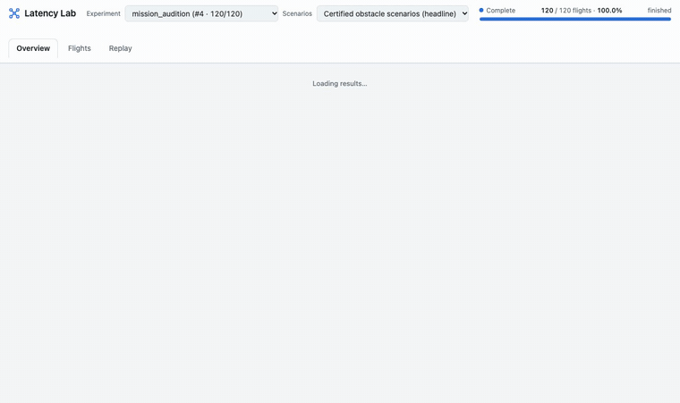

<sub>Dashboard tour, ending in a side-by-side replay of the same scenario: Jev (left) dodges, GPT-6 Luna (right) is still deciding when it hits. <a href="assets/demo/dashboard-tour.mp4">Watch the MP4</a>.</sub>

</div>

---

## Documentation

| Document | What it covers |
|---|---|
| **[docs/FINDINGS.md](docs/FINDINGS.md)** | Every finding across all simulations, rule-based vs LLM vs oracle on every task, a scorecard of the predictions, and a comment on AI vs rule-based vs traditional ML |
| **[docs/ARCHITECTURE.md](docs/ARCHITECTURE.md)** | The full architecture and a file-by-file guide to the codebase, with Mermaid diagrams, and how to extend it |
| [docs/SIMULATIONS.md](docs/SIMULATIONS.md) | The ten simulations in detail |
| [docs/sims/orbs.md](docs/sims/orbs.md) | The Orb Dodge game, swarms and the tournament |
| [docs/LIVE-RESULTS.md](docs/LIVE-RESULTS.md), [docs/MISSION-DEMO.md](docs/MISSION-DEMO.md) | The live-model benchmark and the mission demo |
| [docs/MASTER-PLAN.md](docs/MASTER-PLAN.md) | The original design, trade-offs and research |

## Why this exists

Fast decision models (Jev's "System One", OpenAI's Decisions API, and others) promise sub-second answers. A drone moving at 2 m/s covers a metre in the time a 500 ms model takes to answer. So: **how much does decision latency actually cost, and when does a smarter-but-slower model lose to a dumber-but-faster one?**

This project answers that with a controlled experiment rather than a demo. A simulated Crazyflie flies toward a goal while obstacles appear, intruders cross, the battery dies, or GPS drops. A decision layer picks one of 11 discrete actions and an ordinary PID controller does the flying. Every arm faces the same seeded scenarios, and each model's *measured* wall-clock latency is converted into simulator time, so a fast simulator never hides slow decisions.

## Highlights

- **Honest time model.** The simulator runs faster than real time, so latency is injected as ticks (`apply at t + ceil(L/dt)`). Lockstep timing is kept only as a labelled ablation because it hides latency completely.
- **Certified, budgeted scenarios.** Difficulty is a *reaction budget* in seconds. Scenarios are generated budget-first and certified avoidable by a zero-latency oracle, so collision rate is interpretable. Impossible controls are generated and reported separately.
- **Real models, real calls.** Jev, mercury-decide, GPT-4o-mini, GPT-6 Luna and Gemini fly the same scenarios under a hard USD cap enforced in code.
- **Fair baselines.** Rule-based arms are tuned with an equal budget on held-out seeds; a privileged oracle and hover/random floors bound the results; a reflex shield is an experiment factor, so a 20 ms brake is not mistaken for a smart decision.
- **Everything local.** SQLite for results, Parquet for trajectories, a resumable job queue, a FastAPI read API, a single-file dashboard, and a static HTML report. No Docker, no cloud, no telemetry.
- **Mission mode with 3D replay.** Multi-station tasks (scan, dodge, land), a model audition, and a chase-camera render of the winner with a live decision HUD.
- **Statistics included.** Wilson intervals, exact McNemar tests, Holm correction, power calculations.

## Demo

<table>
<tr>
<td width="50%">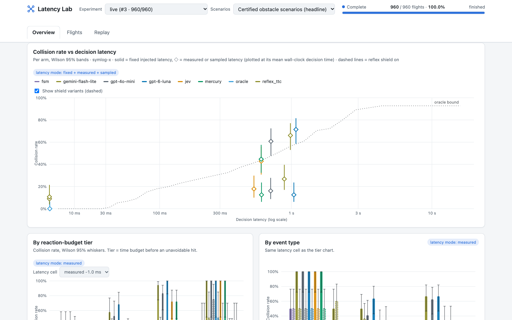<br><sub><b>Live models on the latency curve.</b> Each model is a point at its own measured latency; the dotted line is what a collision-free reactor cannot beat.</sub></td>
<td width="50%">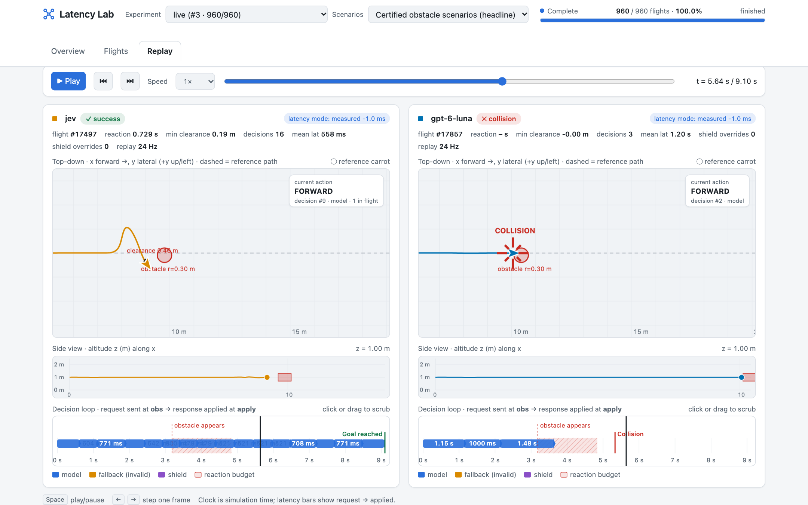<br><sub><b>Side-by-side replay.</b> Same scenario, same clock. Bars show each request being sent and applied; Luna's third decision takes 1.5 s.</sub></td>
</tr>
<tr>
<td>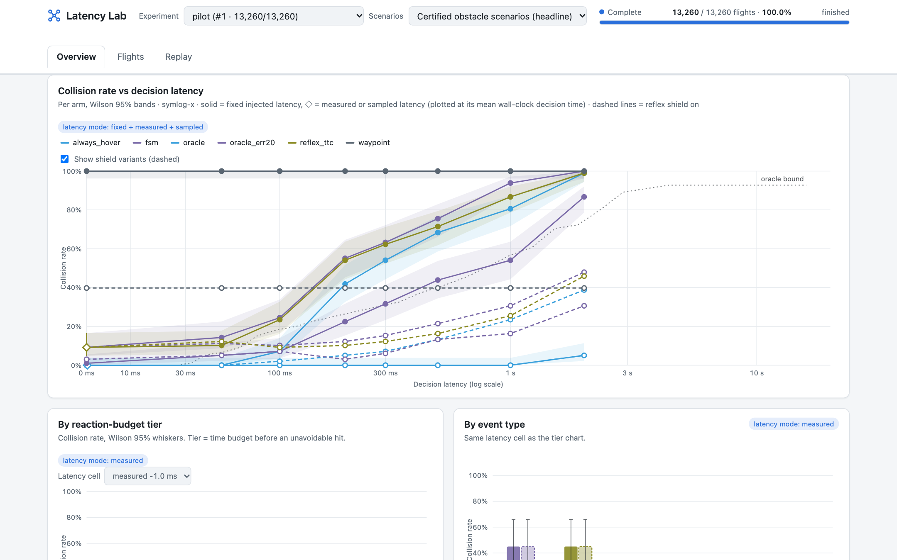<br><sub><b>Injected-latency sweep.</b> Six arms, eight latencies, shield off and on. The knee sits at 100 to 200 ms.</sub></td>
<td>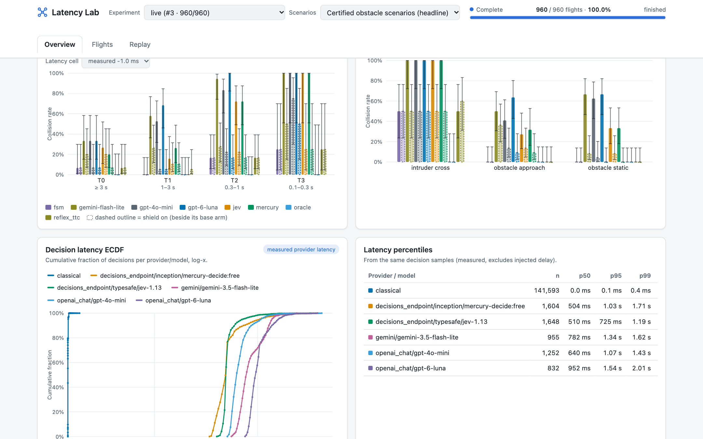<br><sub><b>Where models separate.</b> By reaction-budget tier and event type, plus decision-latency ECDFs and percentiles.</sub></td>
</tr>
<tr>
<td>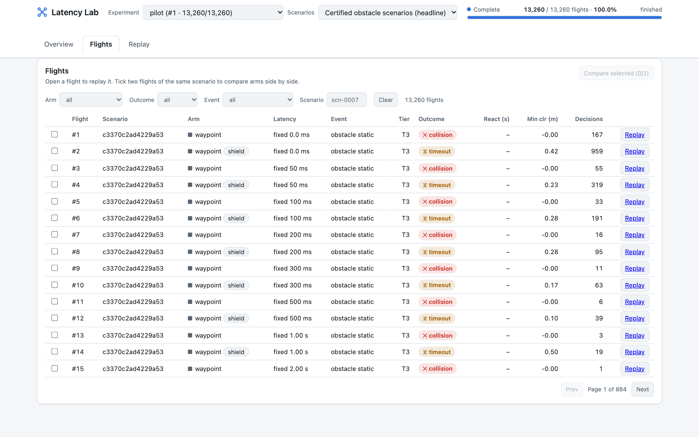<br><sub><b>Every flight is inspectable.</b> Filter, tick two flights of one scenario, and compare them.</sub></td>
<td>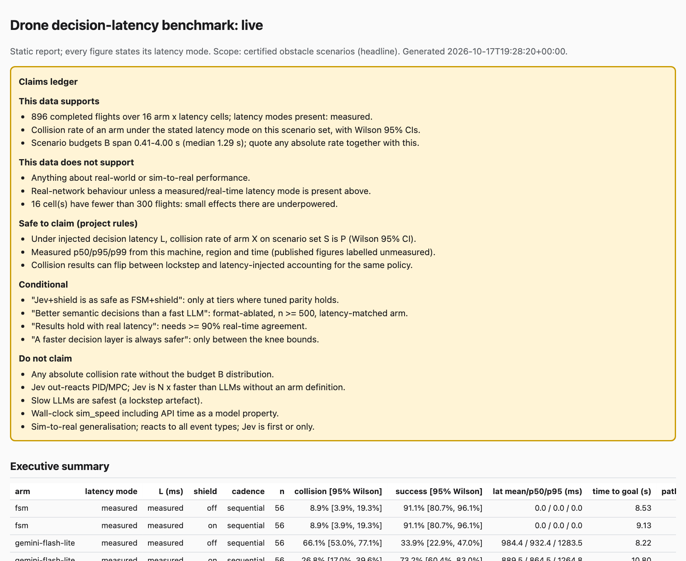<br><sub><b>Static report</b> with a claims ledger stating what the data does and does not support.</sub></td>
</tr>
<tr>
<td>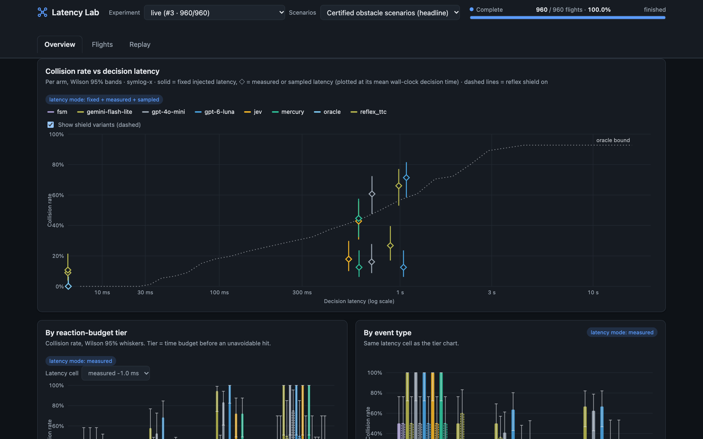<br><sub><b>Dark mode</b> follows your system theme.</sub></td>
<td align="center">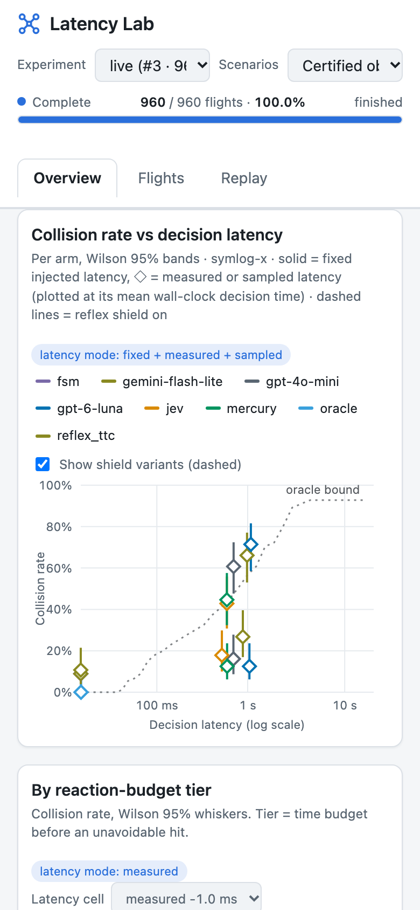<br><sub><b>Phone-friendly.</b></sub></td>
</tr>
</table>

## Mission demo: the best model flies a real task

Beyond the benchmark, four live models **audition** on the same set of multi-step missions, and the winner is rendered flying one in 3D. Each mission: scan three stations (line up, then hold still inside the ring for a second), dodge three hazards (a static block, a drifting object, a crossing intruder), then land on the pad. The model picks one of the 11 discrete actions about twice a second; the PID does the flying.

<div align="center">

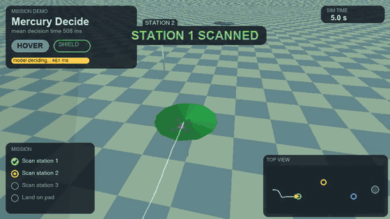

<sub>Highlight clip: Mercury Decide dodges a block and scans station 2. Full flights: <a href="assets/mission/winner/flight.mp4">winner (MP4)</a> · <a href="assets/mission/jev/flight.mp4">Jev 1.13 (MP4)</a>. Replays of recorded flights, drawn with PyBullet's renderer; the drone is drawn 4× larger than real.</sub>

</div>

<table>
<tr>
<td width="33%">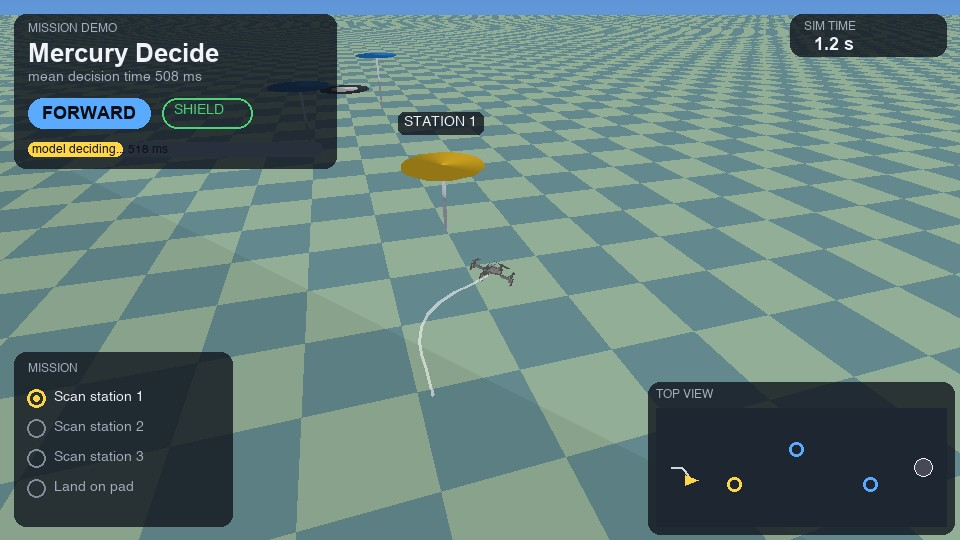<br><sub><b>Start.</b> Model deciding (yellow bar), checklist and top view.</sub></td>
<td width="33%">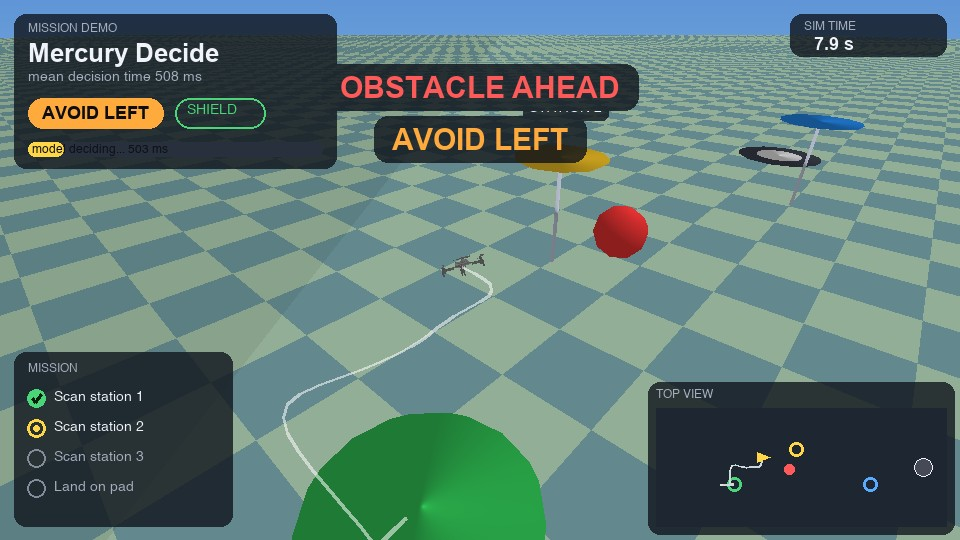<br><sub><b>Hazard.</b> The block appears; the model answers <code>AVOID LEFT</code> about half a second later.</sub></td>
<td width="33%">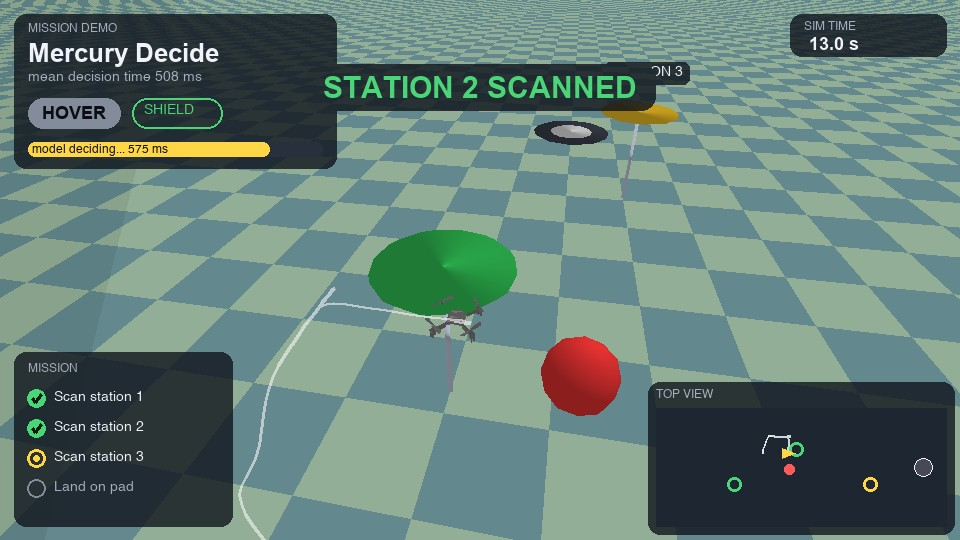<br><sub><b>Scan.</b> Aligned, braked and held still: the ring turns green.</sub></td>
</tr>
<tr>
<td>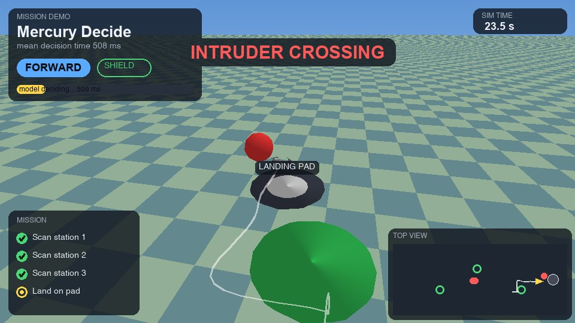<br><sub><b>Intruder.</b> A crosser cuts in just before the pad.</sub></td>
<td>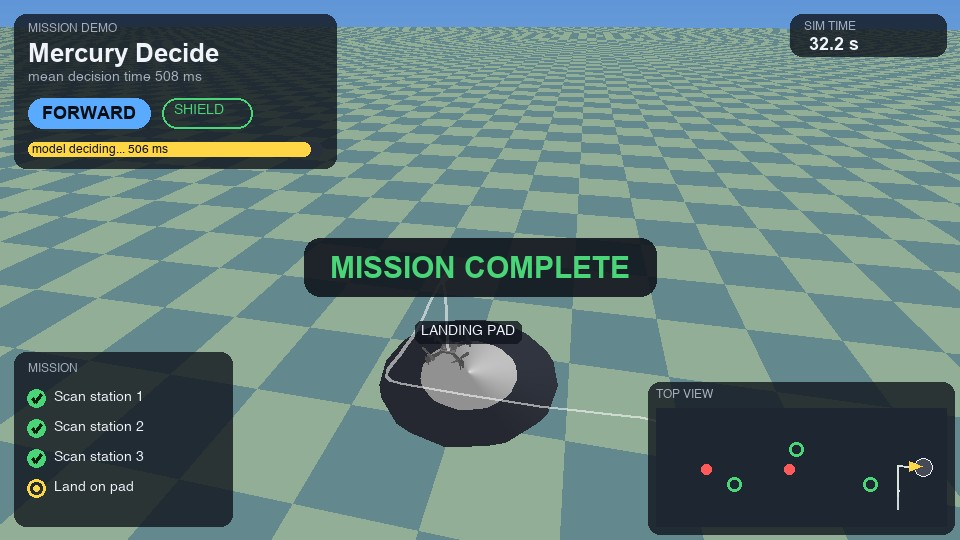<br><sub><b>Landing.</b> <code>EMERGENCY LAND</code> over the pad ends the mission.</sub></td>
<td>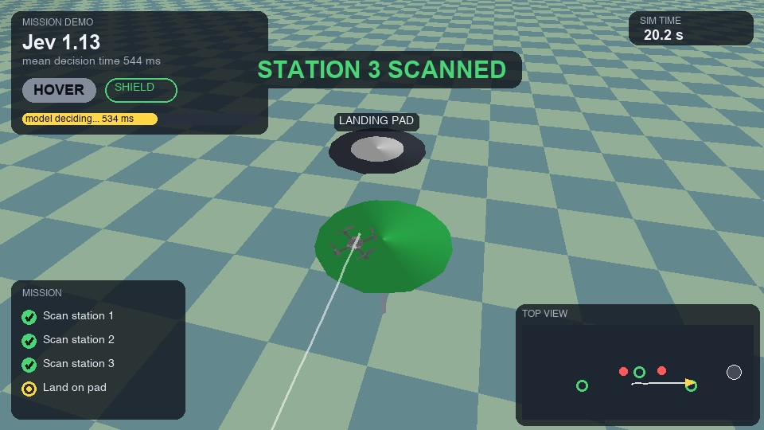<br><sub><b>Jev 1.13</b> on its own median successful run (a near-tie with the winner).</sub></td>
</tr>
</table>

**Audition** (12 certified missions per cell, each model at its own measured latency, $0.28 in total). A mission counts only if all three stations are scanned and the drone lands on the pad without a collision.

| arm | shield | missions completed | stations scanned (of 3) | mean decision latency |
|---|---|---|---|---|
| rule-based pilot (reference, certifies the missions) | off | 12 / 12 | 3.00 | about 0 ms |
| **Mercury Decide** (winner) | on | **5 / 12** | 2.42 | 548 ms |
| **Jev 1.13** | on | 4 / 12 | 2.00 | 554 ms |
| Mercury Decide / Jev 1.13 | off | 1 / 12 each | 1.92 / 1.83 | about 580 / 551 ms |
| Gemini 3.5 Flash-Lite | on | 0 / 12 | 0.42 | 1007 ms |
| GPT-4o-mini | on | 0 / 12 | 0.00 | 673 ms |

The winner was chosen by a rule fixed beforehand (success rate, then stations scanned, then fewest collisions). **Mercury beat Jev by one mission, which is a statistical tie** (exact McNemar p = 1.0), so both are rendered. The reflex shield helped both (suggestive, not significant at n = 12). GPT-4o-mini never issued `HOVER`, so it never stopped to scan and flew out of the arena on every mission. Details, caveats and how the rendered runs were picked (median successful run, not the best): **[docs/MISSION-DEMO.md](docs/MISSION-DEMO.md)**.

## More simulations: ten tasks, each tested against a written prediction

Beyond the mission demo there are ten more tasks you can watch, each run against a prediction written before the data: **only 4 of 11 predictions held** (5 were falsified, 2 held in part). Every video is a side-by-side replay of two recorded flights on the same scenario; the tables are the evidence. Full results, caveats and the live-model runs ($0.72 in total): **[docs/SIMULATIONS.md](docs/SIMULATIONS.md)**.

<div align="center">

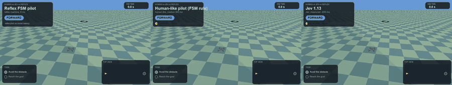

<sub>Human vs Jev vs reflex: the FSM rule with no latency, the same rule with a human-like reaction time (median 300 ms), and Jev (about 600 ms). The first two avoid the obstacle; Jev collides. A reaction time of about 450 ms is where a rule-following operator and Jev become equivalent on this suite.</sub>

</div>

<table>
<tr>
<td width="33%">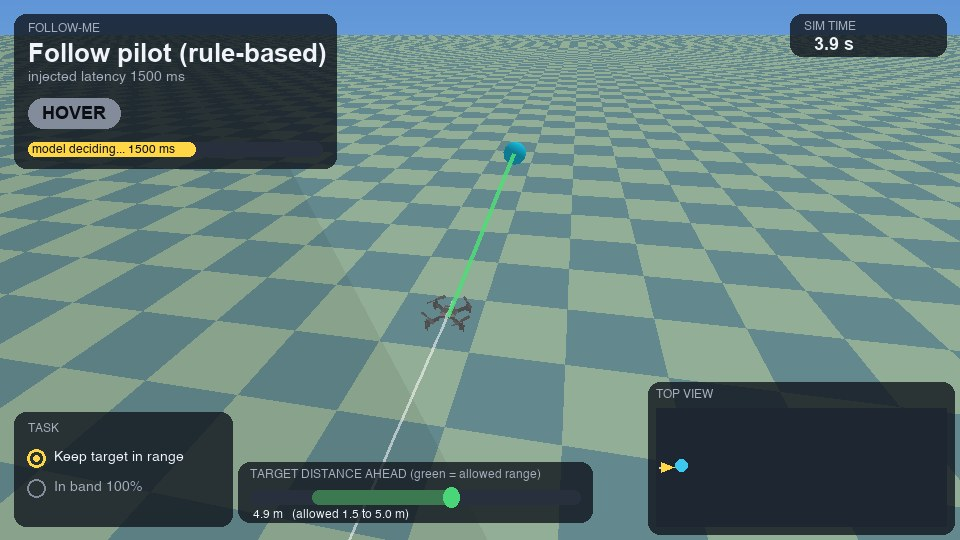<br><sub><b>Follow-me.</b> A weaving target at 1500 ms: the tether turns red. Weaving targets break first (3 of 12 at 1 s). <a href="assets/sims/follow/compare.mp4">video</a></sub></td>
<td width="33%">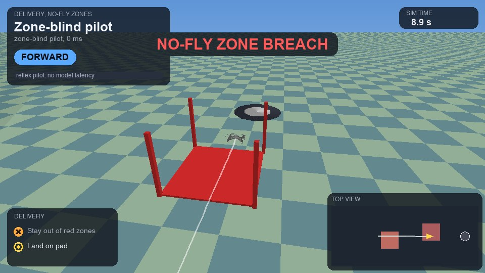<br><sub><b>Delivery, no-fly zones.</b> A zone-blind pilot flies through the red zone. A graded breach metric added no power here. <a href="assets/sims/delivery/compare.mp4">video</a></sub></td>
<td width="33%">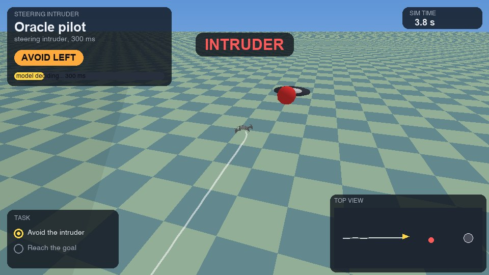<br><sub><b>Steering intruder.</b> The oracle pilot drops to 67% success against a steering intruder at 100 ms; against a straight one it is still at 88% at 1.2 s. <a href="assets/sims/pursuit/paired.mp4">video</a></sub></td>
</tr>
<tr>
<td>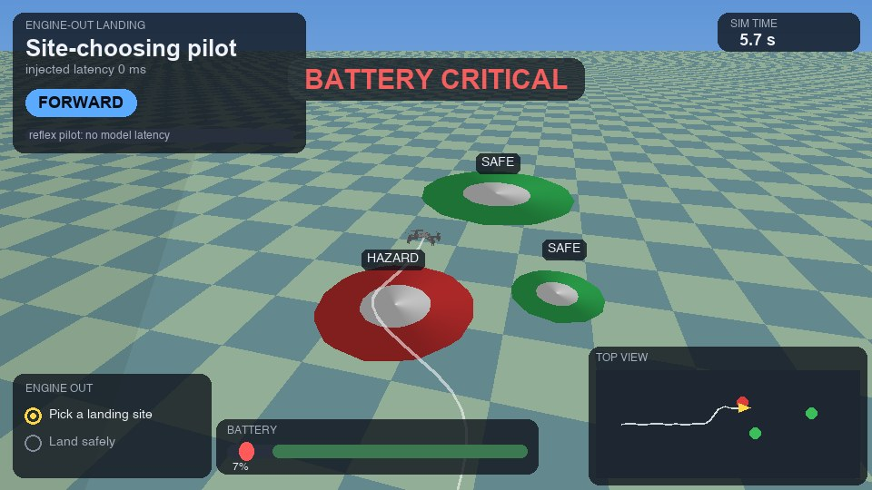<br><sub><b>Engine-out landing.</b> Three sites, one a hazard, 8 s of battery. "Best" wins to 1 s; "nearest" wins by 1.5 s. <a href="assets/sims/landing/compare.mp4">video</a></sub></td>
<td>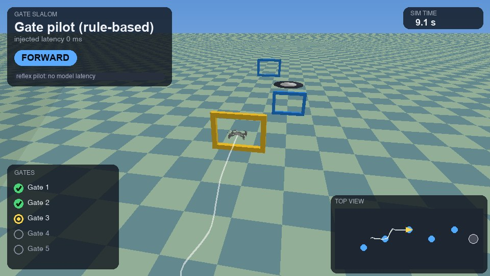<br><sub><b>Gate slalom.</b> 24 of 24 at 100 ms, 0 of 24 at 200 ms: the sharpest cliff in the set. <a href="assets/sims/gates/compare.mp4">video</a></sub></td>
<td>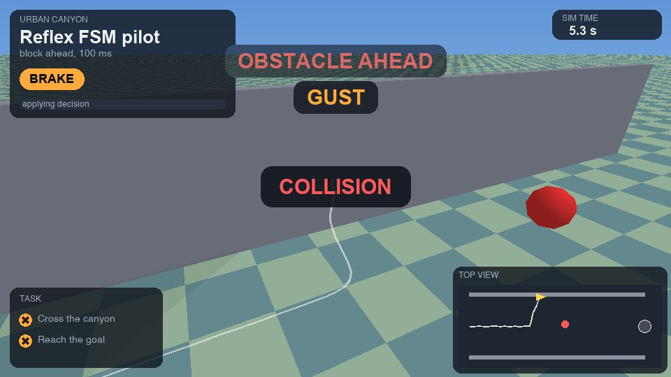<br><sub><b>Urban canyon.</b> The gust control is flat at 100% (the drone never moves more than 0.2 m), so it proves little. <a href="assets/sims/canyon/compare.mp4">video</a></sub></td>
</tr>
<tr>
<td>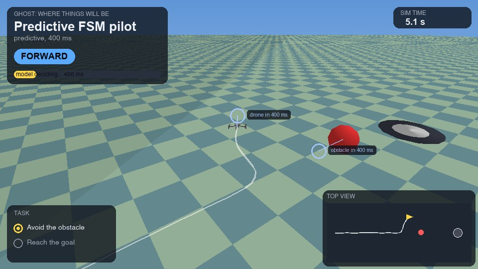<br><sub><b>Ghost drone.</b> Rings show where things will be when a 400 ms answer lands. Extrapolating recovers about 0% of the penalty. <a href="assets/sims/ghost/compare.mp4">video</a></sub></td>
<td>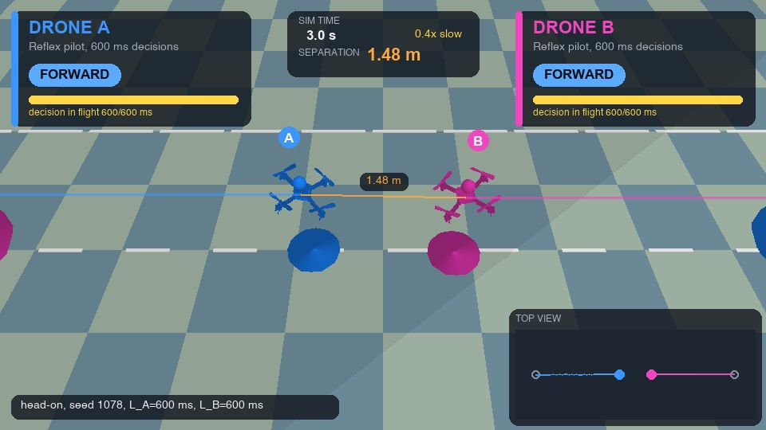<br><sub><b>Two drones.</b> Risk follows the <i>faster</i> drone, not the sum of latencies; no deadlocks in 8,800 flights. <a href="docs/sims/two-drone.md">write-up</a></sub></td>
<td>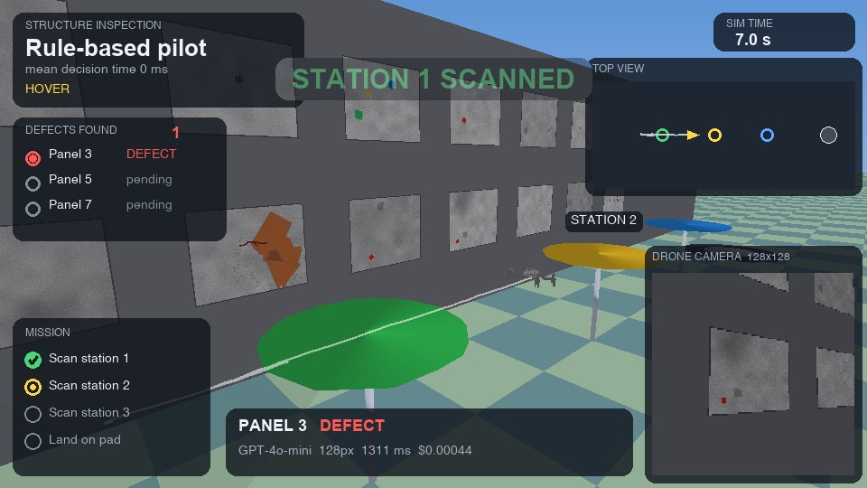<br><sub><b>Inspection with a camera.</b> Accuracy saturates near 128 px for two of three vision models; image size costs only 35 to 53 ms. <a href="docs/sims/inspection.md">write-up</a></sub></td>
</tr>
</table>

### Orb Dodge: a game

A small arena game on the same simulator: three homing orbs chase the drone, which has to dodge all of them and land. It runs with rule-steered orbs against a dodge pilot, with a **small model steering the orbs against a stronger model flying the drone**, with every pairing of rule or model as chaser and dodger, with six-orb swarms, and a randomised round robin of every dodger against every chaser (rule or model on either side), with the chasers also drawn as rival drones. The drone is the real PyBullet quadrotor; the orbs are stylised game objects. Homing orbs punish latency hard: a pilot that survives 24 of 24 at 0 ms survives 0 of 24 at 300 ms. Write-up and caveats: **[docs/sims/orbs.md](docs/sims/orbs.md)**.

<div align="center">

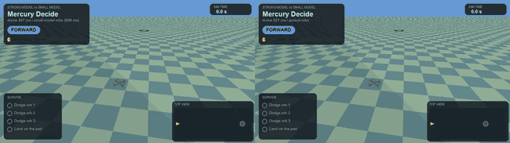

<sub>Mercury Decide flies against orbs steered by gpt-4o-mini (left, dodges all three and lands) and against rule-based pursuit orbs (right, dodges all three but overshoots the pad). Also: <a href="assets/sims/orbs/orb-dodge/orb-dodge.mp4">rule pilot at 0 ms vs 300 ms</a> · <a href="assets/sims/orbs/rule-vs-models/rule-vs-models-homing.mp4">rules vs Mercury vs Jev</a> · <a href="assets/sims/orbs/roles/roles.mp4">who chases, who dodges</a> · <a href="assets/sims/orbs/swarm/swarm-models.mp4">orb swarm</a> · <a href="assets/sims/orbs/swarm/swarm-drones.mp4">rival drone swarm</a> · <a href="assets/sims/orbs/chaser-drones/chaser-drones.mp4">rival chaser drones</a> · <a href="assets/sims/orbs/tournament/tournament-llm-vs-llm.mp4">LLM vs LLM</a> · <a href="assets/sims/orbs/tournament/heatmap.png">tournament heatmap</a>.</sub>

</div>

**Live models on four of the tasks** (12 scenarios each, each model at its own measured latency): Mercury Decide completed follow-me 12 of 12 (the rule-based pilot also 12), Jev 8, GPT-4o-mini 0, Gemini 3.5 Flash-Lite 3. Every model failed the gate slalom (0 of 12), as the 200 ms cliff predicts. In the delivery task the models mostly ignored the zones (deepest breach 0.34 to 0.49 m, the same as a zone-blind pilot). Small samples, one fixed prompt each; read the caveats.

## Results

All numbers: certified obstacle scenarios, this machine and network (client in India, so API latencies are higher than published). Full write-up with every caveat: **[docs/LIVE-RESULTS.md](docs/LIVE-RESULTS.md)**.

### Injected-latency sweep

Collision rate of the privileged oracle by decision latency (130 scenarios):

| latency | 0 ms | 50 | 100 | 200 | 300 | 500 | 1000 | 2000 |
|---|---|---|---|---|---|---|---|---|
| shield off | 0% | 0% | 7% | 42% | 54% | 68% | 81% | 99% |
| shield on | 0% | 0% | 2% | 5% | 7% | 13% | 23% | 39% |

The knee is at 100 to 200 ms, and a reflex shield flattens the curve a lot.

### Live models

60 paired scenarios, reaction budgets 0.4 to 4 s, 6,891 real API calls, $0.45 total:

| arm | mean decision latency | collisions, no shield | collisions, shield on | acceptable actions |
|---|---|---|---|---|
| **Jev** (`typesafe/jev-1.13`) | 601 ms | **43%** | 18% | 95% |
| mercury-decide | 611 ms | 45% | 12% | 96% |
| GPT-4o-mini | 718 ms | 61% | 16% | 92% |
| Gemini 3.5 flash-lite | 976 ms | 66% | 27% | 93% |
| GPT-6 Luna (reasoning off) | 1080 ms | 71% | 12% | 95% |
| tuned reflex / FSM | about 0 ms | 9% | 9 to 11% | 96% |
| oracle (privileged) | 0 ms | 0% | 0% | 100% |

**Findings**

1. **Latency separates the models, not judgement.** Every model picks an acceptable action 92 to 96% of the time, yet collisions rise in the order of measured latency. Jev beats Luna, Gemini and GPT-4o-mini (Holm-corrected p = 0.0006, 0.007, 0.04) and ties mercury-decide.
2. **No decision model out-reacts a reflex controller.** The tuned rule-based arms collide 9% of the time versus Jev's 43% (+34 points, p < 0.0001). A decision model's value is choosing *what* to do, not reacting faster than a reflex.
3. **A reflex shield erases most of the differences.** With the shield on, all models land at 12 to 27% with no significant gaps (n = 56). Design the shield first.
4. **Slack is the currency.** With 1 to 2 s of reaction budget Jev collides 16% of the time versus 68% for Luna; below 1 s nobody copes.

> **Read the caveats.** About 56 scenarios per cell, so differences under roughly 15 points are not resolved. Latency is injected from measured wall-clock time on one network and not validated in real time. Simulation only (a 27 g Crazyflie model), no claim about real hardware. Details in [docs/LIVE-RESULTS.md](docs/LIVE-RESULTS.md#caveats-read-before-quoting).

## Quick start

Requires macOS (Apple silicon tested) or Linux, a C compiler (pybullet has no macOS wheel and builds from source) and [`uv`](https://docs.astral.sh/uv/).

```bash
git clone <this repo> && cd <this repo>
bash scripts/setup_sim_env.sh            # venv (Python 3.14.2), dependencies, pybullet + gym-pybullet-drones
cp .env.sample .env                      # add OPENROUTER_API_KEY / OPENAI_API_KEY / GEMINI_API_KEY (optional)
.venv/bin/python -m pytest -q            # 221 tests, no network or API keys needed
```

Run the classical experiments (free, no network) and open the dashboard:

```bash
.venv/bin/python scripts/tune_arms.py        # one-off: tune the rule-based arms on a held-out suite (about 6 min)
.venv/bin/python scripts/run_experiment.py   # calibrate, generate + certify scenarios, fly the grid (about 9 min)
.venv/bin/uvicorn main:app --port 8765       # open http://127.0.0.1:8765/dashboard
.venv/bin/python scripts/make_report.py      # static HTML reports -> reports/
```

Fly the live models (uses your keys, hard-capped by `BUDGET_USD`, default $15; about $0.45 and 21 minutes):

```bash
.venv/bin/python scripts/run_live.py
```

Arms whose API key is missing are skipped.

Run the mission audition and render the winner in 3D (about $0.28 and 14 minutes in total):

```bash
.venv/bin/python scripts/run_missions.py     # 12 certified missions x 4 live models x shield off/on
.venv/bin/python scripts/render_mission.py   # pick the winner, write assets/mission/<winner|jev>/
```
 No data yet? `.venv/bin/python scripts/seed_demo_db.py` writes a fake demo database to `data/demo.db`; point the app at it with `DB_PATH=data/demo.db`.

<details>
<summary><b>Regenerating the screenshots and demo video</b></summary>

```bash
uv pip install -r requirements/docs.txt && .venv/bin/playwright install chromium
.venv/bin/uvicorn main:app --port 8765 &        # the server must be running
.venv/bin/python scripts/capture_docs_media.py  # writes assets/dashboard/*.png and assets/demo/ (needs ffmpeg)
```

The script drives a real Chromium against the dashboard, so the media is always from the actual app on the actual data.

</details>

## How it works

A short version follows; the full guide with every module, diagram and extension recipe is **[docs/ARCHITECTURE.md](docs/ARCHITECTURE.md)**.

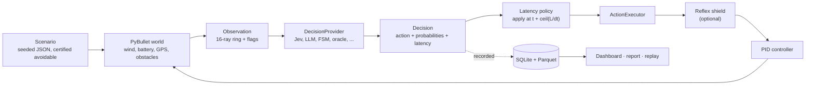

- **Time model.** A decision requested at tick `t` is applied at `t + ceil(L/dt)` and the previous action stays in force meanwhile. Provider calls are made synchronously ("pause and charge"), so wall time spent in an API call never advances the simulator; it is converted to ticks instead.
- **Reaction budget `B`.** The extra time, beyond the physical minimum, that a decision layer has before avoidance becomes impossible. A layer with effective latency `L` can only avoid scenarios with `B` of roughly `L` or more, so collision rate against latency is the cumulative distribution of the budgets. Always report curves with the budget distribution.
- **Arms.** `waypoint` (no avoidance), `reflex_ttc` and `fsm` (rule-based, tuned), `oracle` and `oracle_err*` (privileged; fixed accuracy for separating speed from smartness), `always_hover` and `random` (floors), plus live providers.
- **11 actions.** `FORWARD`, `LEFT`, `RIGHT`, `ASCEND`, `DESCEND`, `BRAKE`, `HOVER`, `AVOID_LEFT`, `AVOID_RIGHT`, `RETURN_HOME`, `EMERGENCY_LAND`. Models never touch the motors.
- **Shield.** A reflex layer that brakes forward motion when sensed range enters the stopping envelope. It never cancels a sidestep in progress.

## Project layout

| Path | What |
|---|---|
| `app/domain/` | Action enum, `Observation`, `Decision`, `DecisionProvider` protocol, trajectory file contract |
| `app/sim/` | PyBullet world (wind, gusts, battery, obstacles, a steering intruder, walls, rays), mission and task trackers (follow, zones, landing sites), two-drone world, inspection world, seeded random streams |
| `app/controllers/` | Action executor, reflex shield, classical arms |
| `app/oracle/` | Ground-truth action labeller (`label_v1`) |
| `app/scenarios/` | Scenario spec, calibration, generator + certification, mission generator |
| `app/providers/` | Jev / decision-endpoint, OpenAI, Gemini, mock; prompt encoding, parsing, cache, budget ledger |
| `app/harness/` | Flight runner, latency policies, SQLite store and queue, worker, supervisor |
| `app/analysis/` | Statistics (Wilson, McNemar, Holm, power) and the static report |
| `app/render/` | 3D renderers (PyBullet scene, chase camera, HUD) for the mission demo and the simulations, and the video pipeline |
| `app/api/v1/`, `app/services/`, `app/repositories/` | Read-only FastAPI: results, curves, replay, SSE progress |
| `static/dashboard.html` | Single-file dashboard: curves, tables, flights, replay with decision Gantt |
| `configs/experiments/` | Experiment YAML; `configs/tuned_arms.json` holds tuned thresholds |
| `scripts/` | Setup, tuning, experiment and live runners, reports, demo seed, media capture |
| `tests/unit/` | Unit and integration tests |
| `docs/` | [Findings](docs/FINDINGS.md), [architecture](docs/ARCHITECTURE.md), [master plan](docs/MASTER-PLAN.md), [live results](docs/LIVE-RESULTS.md), [mission demo](docs/MISSION-DEMO.md), [simulations](docs/SIMULATIONS.md), [build log](docs/PROGRESS.md), [15+ research notes](docs/research/) |

## Limitations and roadmap

The ten Group A simulation ideas are built and written up in [docs/SIMULATIONS.md](docs/SIMULATIONS.md). The remaining ideas (latency-aware prompting, cadence sweeps, latency tails, a hybrid three-tier controller, ...), ranked with effort and falsifiable predictions, are in **[docs/SIMULATION-IDEAS.md](docs/SIMULATION-IDEAS.md)**.


- Simulation only; one drone model; one network location (latencies are not portable).
- Sequential decision cadence only in the experiments (the runner also supports periodic).
- Not built yet: MPC and RL arms, a faster kinematic simulator tier, multimodal input inside the flight loop (a camera demo exists as a separate study), a real-time-paced validation set. The [master plan](docs/MASTER-PLAN.md) sizes each of these.
- Jev's OpenRouter endpoint is alpha; behaviour and limits may change.
- The prompt's `age` field (data staleness) was not wired in for the live runs, so models were not told how old their data was.

## Contributing

Issues and pull requests are welcome; see [CONTRIBUTING.md](CONTRIBUTING.md). The short version:

```bash
.venv/bin/ruff check . && .venv/bin/ruff format app scripts tests utils && .venv/bin/mypy --explicit-package-bases . && .venv/bin/python -m pytest -q
```

Project conventions live in [`.github/copilot-instructions.md`](.github/copilot-instructions.md) (full type hints, class-based services, no `print`, `uv`).

## Acknowledgements

- [gym-pybullet-drones](https://github.com/learnsyslab/gym-pybullet-drones) and [PyBullet](https://pybullet.org/) for the simulator and the PID controller.
- [TypeSafe AI](https://docs.typesafe.ai/introduction) for Jev and its System One decision interface, and [OpenRouter](https://openrouter.ai/) for the Decisions endpoint used to reach it.
- [RomanSlack/jev-drone](https://github.com/RomanSlack/jev-drone), the closest prior art (Jev driving a MuJoCo drone under a reflex veto), which this project extends with a controlled latency study.
- OpenAI, Google and Inception for the other models benchmarked here.

## License

[MIT](LICENSE). API keys are read from `.env` (git-ignored) and never logged or stored.
