# Architecture and code guide

How the codebase is organised, how a flight runs, where every piece lives, and how to extend it. Diagrams are Mermaid (they render on GitHub). File references are relative to the repository root.

Related: [FINDINGS.md](FINDINGS.md) (what was measured), [SIMULATIONS.md](SIMULATIONS.md), [sims/orbs.md](sims/orbs.md), [MASTER-PLAN.md](MASTER-PLAN.md) (the original design and trade-offs), [`.github/copilot-instructions.md`](../.github/copilot-instructions.md) (coding conventions, the single source of truth for style).

## Contents

1. [What the system is](#1-what-the-system-is)
2. [The big picture](#2-the-big-picture)
3. [Repository map](#3-repository-map)
4. [The core contract: observation, decision, action](#4-the-core-contract-observation-decision-action)
5. [The simulator](#5-the-simulator)
6. [From action to motors: executor, shield and PID](#6-from-action-to-motors-executor-shield-and-pid)
7. [The latency model](#7-the-latency-model)
8. [The flight runner](#8-the-flight-runner)
9. [Scenarios and task families](#9-scenarios-and-task-families)
10. [Decision arms and providers](#10-decision-arms-and-providers)
11. [The experiment harness and SQLite store](#11-the-experiment-harness-and-sqlite-store)
12. [Analysis, API and dashboard](#12-analysis-api-and-dashboard)
13. [Rendering and media](#13-rendering-and-media)
14. [Special studies: two drones, inspection, Orb Dodge](#14-special-studies-two-drones-inspection-orb-dodge)
15. [Scripts](#15-scripts)
16. [Tests](#16-tests)
17. [Design decisions and trade-offs](#17-design-decisions-and-trade-offs)
18. [How to extend it](#18-how-to-extend-it)

---

## 1. What the system is

A **latency laboratory for drone decision models**. It answers: *how fast does a decision layer (an LLM, a rule, an oracle) have to be to keep a simulated drone out of trouble?*

Three ideas run through the code:

1. **The harness owns time.** The simulator never waits for a model. A decision requested at control tick *t* is applied at tick *t + ⌈L / dt⌉* on **simulation** time, where *L* is either injected or the model's real measured wall-clock latency. Until it arrives, the previous action stays in force.
2. **One narrow interface.** Every decision-maker, from a one-line rule to a hosted LLM, takes an `Observation` and returns one of 11 discrete `Action`s. A PID controller does the actual flying.
3. **Everything is paired and reproducible.** Scenarios are seeded and certified, noise depends only on `(seed, tick)`, and every flight is a row in SQLite plus a Parquet trajectory, so any two arms can be compared on identical scenarios.

Stack: Python 3.14 (`uv`), PyBullet through `gym-pybullet-drones` (pinned commit), FastAPI (read-only), SQLite in WAL mode, Parquet, Pydantic v2, Pillow and ffmpeg for media, Ruff, Mypy, pytest.

## 2. The big picture

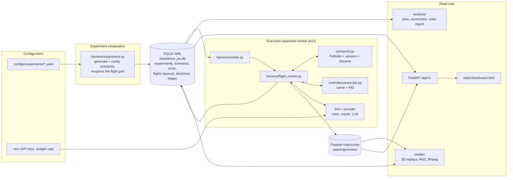

Two kinds of code sit side by side. The **core benchmark** (`app/harness`, SQLite, dashboard) runs experiments from YAML. The **studies** (`scripts/run_*.py`, `app/sim/two_drone.py`, `app/sim/inspection.py`, the orb game) are scripts that reuse the same simulator, runner and renderers, sometimes with their own loop.

## 3. Repository map

```
.
├── main.py                  FastAPI entrypoint (app factory, static dashboard, CORS)
├── app/
│   ├── domain/              the shared contract: Action, Observation, Decision, trajectory columns
│   ├── sim/                 PyBullet world, task trackers, mission tracker, two-drone and inspection worlds
│   ├── controllers/         action executor (carrot+PID), reflex shield, rule-based arms
│   ├── scenarios/           scenario spec (Pydantic), generators, calibration, task-family drawers
│   ├── harness/             flight runner, latency, experiment prep, SQLite store, worker pool, orb control
│   ├── providers/           LLM providers, prompt encoding and rules, parsing, cache, budget ledger
│   ├── oracle/              ground-truth action labeller
│   ├── analysis/            statistics, summaries, static HTML report
│   ├── api/ services/ repositories/ schemas/ db/   read-only FastAPI (layered)
│   ├── render/              3D scene, HUD, video renderers
│   └── core/                settings, logging, exception handlers
├── scripts/                 experiment runners, analysers, renderers, media capture
├── configs/                 experiment YAML, tuned arm thresholds
├── static/dashboard.html    single-file dashboard
├── utils/                   pure helpers (intervals, response envelope, file saving)
├── tests/                   pytest (unit and integration)
├── docs/                    plan, results, simulations, this guide, research notes
└── assets/                  generated media (never hand-edited)
```

### 3.1 `app/domain/` (the contract)

| File | Role |
|---|---|
| `actions.py` | `Action` enum (11 actions), single-letter aliases for one-token LLM answers, the action glossary used in prompts |
| `observation.py` | `Observation` (what a decision-maker sees), `TruthState` (privileged ground truth), sensor constants |
| `decision.py` | `Decision` (action, latency, probabilities, tokens, cost, source), `DecisionSource`, the `DecisionProvider` protocol |
| `trajectory.py` | `TRAJ_COLUMNS`: the per-tick columns of every Parquet trajectory, and the 48 Hz rate |

### 3.2 `app/sim/` (the simulated world)

| File | Role |
|---|---|
| `world.py` | `DroneWorld`: one PyBullet drone (`gym-pybullet-drones`, CF2X, `DSLPIDControl`), 16-ray sensor, obstacles of four kinds, a steering ("pursue") intruder, externally steered orbs, a disc radar, static boxes, wind, gusts, turbulence, battery and GPS faults |
| `tasks.py` | Pure-logic trackers for the task families: `FollowTracker`, `ZoneMonitor`, `LandingTracker` |
| `mission.py` | `MissionTracker`: stations, scan hold, gate mode, pad landing, phases |
| `rng.py` | Arm-independent random streams: each named channel is a Philox generator keyed by `sha256(seed:channel)`, pre-generated by tick, so noise depends only on `(seed, tick)` |
| `two_drone.py` | `TwoDroneWorld`: two drones in one PyBullet client with per-drone sensing and a pair runner |
| `inspection.py` | The inspection scene: wall of panels, defects, camera frames |

### 3.3 `app/controllers/`

| File | Role |
|---|---|
| `executor.py` | `ActionExecutor`: turns the latest action into a moving setpoint ("carrot") and target velocity |
| `shield.py` | `ReflexShield`: a time-to-collision based forward-brake override |
| `arms.py` | The classical arms: waypoint, hover, random, reflex-TTC, FSM, oracle, oracle-with-errors, mission FSM; `build_classical_arm` factory; parameters from `configs/tuned_arms.json` |
| `sim_arms.py` | Task pilots: follow, zones, gates, landing sites, the orb pilot and `OrbDodger`, and `PredictiveArm` |

### 3.4 `app/scenarios/`

| File | Role |
|---|---|
| `spec.py` | Pydantic models: `ScenarioSpec`, `ObstacleSpec`, `MissionSpec`, `TargetSpec`, `ZoneSpec`, `SiteSpec`, `BoxSpec`, `WindSpec`, `SensorSpec` |
| `calibration.py` | Calibrates how close an obstacle may appear so the oracle can still avoid it |
| `generator.py` | Budget-first generator for the obstacle benchmark, with certification and impossible controls |
| `missions.py` | Mission generator (stations, hazards, pad), certified by the mission pilot |
| `sims.py` | Drawers for every other family: follow, delivery, pursuit, landing, gates, canyon, orbs, swarm, randomised orbs |

### 3.5 `app/harness/`

| File | Role |
|---|---|
| `flight_runner.py` | The tick loop (section 8): `run_flight`, `FlightConfig`, outcomes, metrics |
| `latency.py` | `LatencyPolicy` (lockstep, fixed, sampled, measured), `lognormal_trace` |
| `experiment.py` | Prepare an experiment: generate and certify scenarios (per family), enqueue the grid; `FAMILY_PILOTS` |
| `store.py` | `Store`: SQLite access, the work queue with leases |
| `schema.py` | Table definitions and migrations |
| `worker.py`, `supervisor.py` | A worker claims flights and runs them; the supervisor spawns the pool |
| `orb_control.py` | `OrbController`, `OrbView`, `PursuitSteerer`: orb brains with sim-time latency |

### 3.6 `app/providers/`

| File | Role |
|---|---|
| `base.py` | `RemoteProvider`: the template for HTTP providers (client, timing, cache, budget, "never raise") |
| `decisions_endpoint.py` | Jev and Mercury through the OpenRouter Decisions endpoint |
| `openai_chat.py`, `gemini.py` | Chat providers (OpenAI, OpenRouter, Gemini) with logprobs where available |
| `encoding.py` | `ObservationEncoder`: the terse "hybrid" observation text plus task blocks and rules |
| `prompts.py` | The static system prompt, built once from the action glossary |
| `parsing.py` | Parse a model answer to an `Action`; probabilities from logprobs |
| `cache.py`, `budget.py` | Response cache and the hard USD spend cap (`BudgetLedger`) |
| `factory.py` | `build_provider(arm_config)` |
| `mock.py` | Deterministic offline provider, used for tests and error-rate sweeps |
| `orb_llm.py` | A small model as an orb's brain (OpenAI or Gemini through its OpenAI-compatible endpoint) |
| `vision.py` | The vision-model client for the inspection study |

### 3.7 The read side

| Path | Role |
|---|---|
| `app/analysis/stats.py` | Wilson and Clopper-Pearson intervals, exact McNemar, Holm, Wilcoxon, Kaplan-Meier, power |
| `app/analysis/summary.py` | Per-arm summaries, paired comparisons, breakdowns by tier, event and latency |
| `app/analysis/report.py` | A self-contained static HTML report (inline SVG, no external assets) |
| `app/api/v1/*.py` | Routers: health, experiments, results, flights, replay, arms, scenarios, events (SSE), dashboard |
| `app/services/*.py` | Use-case orchestration over repositories |
| `app/repositories/*.py` | Read-only SQL; a missing database gives empty results, never a 500 |
| `app/schemas/api.py` | API DTOs; `app/schemas/experiment.py` the experiment YAML schema |
| `app/db/` | Async SQLite engine in `mode=ro` |
| `static/dashboard.html` | Curves, tables, flight replay with a decision Gantt chart, all in one file |

### 3.8 `app/render/` (see section 13)

`scene.py`, `hud.py`, `mission_video.py` (the original mission renderer), `sim_scene.py` and `sim_video.py` (all other families), `two_drone_video.py`, `inspection_video.py`.

## 4. The core contract: observation, decision, action

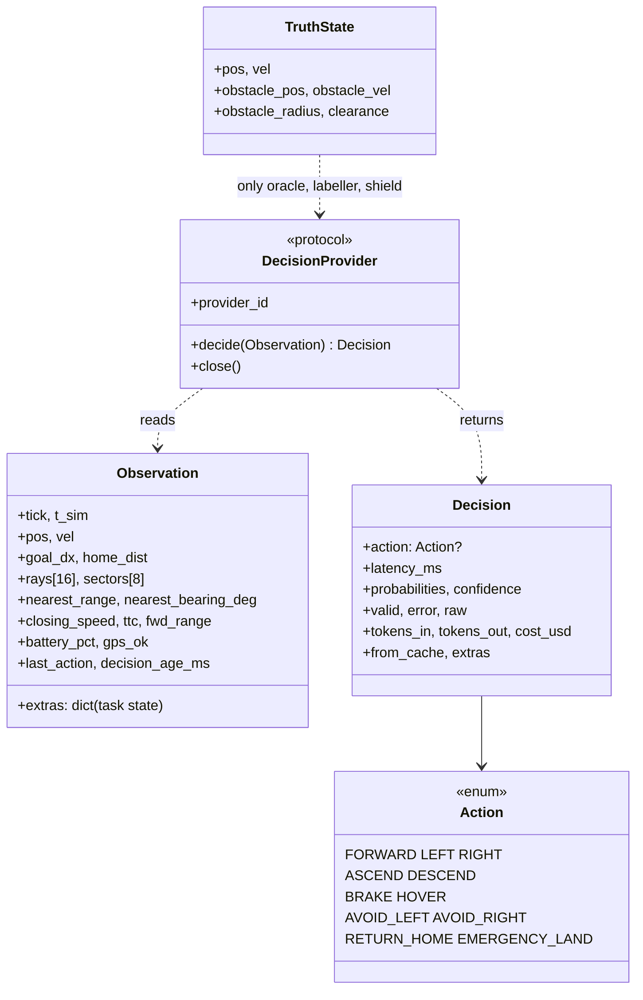

- **Frame:** world axes with yaw held at zero (x toward the goal, y left, z up), so body frame equals world frame. Yaw is deliberately out of scope.
- **`Observation.extras`** carries task state (mission target, follow gap, zone state, landing sites, orb radar). The runner builds it per task; the prompt encoder turns it into bucketed words (`gap=OK lat=LEFT`) because the models are weak at raw numbers.
- **`TruthState`** is privileged and visible only to the oracle, the labeller and the shield.
- The **11 actions** are the whole interface. A sidestep is a fixed 1 to 1.2 m step; forward cruise speed is per scenario.

## 5. The simulator

`DroneWorld` (`app/sim/world.py`) wraps `gym-pybullet-drones`.

- **Clocks:** physics at 240 Hz, control at 48 Hz (`DT = 1/48`); a decision is a control-tick concept.
- **Sensing:** 16 rays spaced 22.5° starting 0.10 m from the drone, 10 m range, Gaussian noise and optional dropout. A forward **corridor** range (rays within 0.6 m of the flight line) feeds `fwd_range` and a smoothed **closing speed**. Objects smaller than the ray spacing slip between rays, so orbs add an analytic **disc radar** (`sense_radius`) that writes a return into the nearest rays and fills the `orb_*` extras.
- **Obstacles** (`ObstacleSpec.kind`): `static`, `approach` (straight toward the drone), `cross` (lateral intruder), `pursue` (steers by proportional navigation, or by an external command when `ext_control` is set). They are spheres, parked under the floor until the drone passes their `trigger_x`, then spawned relative to the drone. They move kinematically; contact and clearance are checked with PyBullet.
- **Static boxes** (`BoxSpec`, e.g. canyon walls) are real collision bodies and show up in the rays.
- **Environment:** steady wind and OU turbulence as horizontal acceleration, a **gust burst**, battery drain and a sudden drop (landing task), GPS loss (position freezes).
- **Out of bounds:** |y| > 6 m, z > 4 m, x < -3 m or x > goal + 6 m ends the flight as a crash.

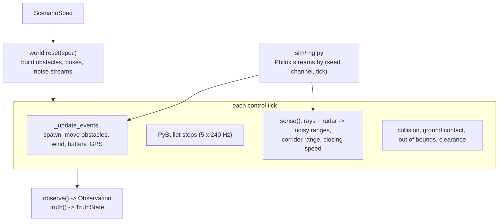

Determinism: sensor noise, dropout, turbulence and spawn offsets come from `rng.py` by channel and tick, so the same scenario produces the same world no matter which arm is flying.

## 6. From action to motors: executor, shield and PID

`ActionExecutor` (`app/controllers/executor.py`) converts the *latched* action into a moving reference point (the "carrot") and a target velocity for `DSLPIDControl`.

- Forward: carrot advances at cruise speed, acceleration-limited (`A_SLEW` 3.0 m/s²). `BRAKE` and `HOVER` stop it (`A_BRAKE` 4.5 m/s²).
- Lateral: `LEFT`/`RIGHT` set a target 1.0 m to the side at 1.5 m/s; `AVOID_*` 1.2 m with the forward speed halved for 1.5 s (`AVOID_SLOW_*`). Targets clamp at |y| = 3.5 m. Repeating a lateral action moves the target further.
- Vertical: ±0.5 m steps.
- `EMERGENCY_LAND` is irreversible. The carrot lead is bounded (`CARROT_LEAD_*`) so a sagging drone is pulled back instead of dragging the setpoint down.
- A **side-commit hysteresis** (0.5 s) stops left/right flip-flops.
- `keep_lateral_on_stop` (set for missions, follow and landing) lets a `HOVER` finish an in-progress sidestep.

The stock PID is unstable when commanded lateral acceleration exceeds about 3 m/s², which is why every dodge is slow and why these constants are what they are.

`ReflexShield` (`shield.py`) is the safety override: when something in the forward corridor is closing (more than 0.3 m/s) and its range falls below the stopping distance `v·0.08 s + v² / 2a` plus a 0.45 m margin, it forces a brake and holds it for at least 1.2 s. It stops *forward* motion only; a sidestep already under way is allowed to finish. In zone tasks the same "shield" flag acts as a **geofence**, and in orb games it is replaced by the orb reflex (`OrbDodger`).

## 7. The latency model

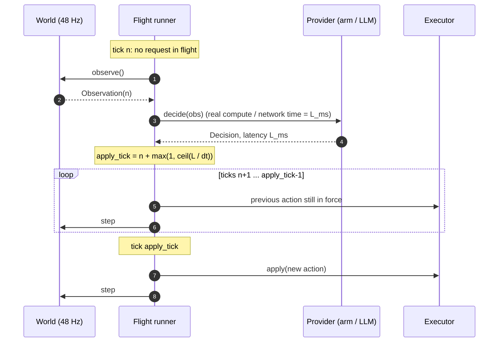

`LatencyPolicy` (`app/harness/latency.py`) decides which *L* is used:

| Mode | L is | Used for |
|---|---|---|
| `lockstep` | 0 (applied the same tick) | ablation only |
| `fixed` | the injected value | the latency sweeps |
| `sampled` | drawn from a trace (`lognormal_trace`, seeded) | the human-like baseline |
| `measured` | the provider's own wall-clock time | live models |

In `sequential` cadence (the default) a new request is issued only when none is in flight, so a 600 ms model looks at the world about every 0.6 s and its effective reaction delay is up to about twice *L*. A `periodic` cadence is also implemented but not used in the experiments.

## 8. The flight runner

`run_flight(world, spec, provider, cfg)` in `app/harness/flight_runner.py` runs one flight and returns metrics, decision rows and a trajectory. One `_Flight` object holds the mutable state.

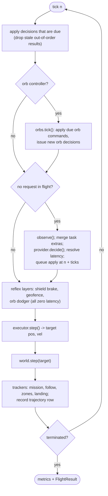

- **Trackers** (`MissionTracker`, `FollowTracker`, `ZoneMonitor`, `LandingTracker`) are pure-logic classes that update from the true position each tick, emit events (`scanned`, `missed`, `breach`, `lost`, `overran`) and contribute task metrics to `flights.task_json`.
- **Outcomes** are one of `success`, `collision`, `crash` (ground, out of bounds or hard landing), `timeout`, `landed`, `landed_on_pad`, `landed_off_pad`, `landed_safe`, `landed_hazard`, `landed_off_site`, `completed`, `lost`, `overran`, `gates_done`.
- **Success definitions** are per task: obstacle events need the deadline met without an unsafe outcome; missions need every station scanned and a pad landing; follow needs completion with at least 70% time in band; gates need every gate passed; delivery additionally needs no zone breach deeper than 2 cm.
- **Labelling:** for benchmark scenarios each decision is checked against the oracle labeller (`app/oracle/labeller.py`, `label_v1`), which computes the *acceptable* action set by short point-mass rollouts under the executor's own constants. This gives the "acceptable action" rate.
- **Event-type sets** `OBSTACLE_EVENTS`, `DEADLINE_EVENTS` and `EVASIVE` classify which scenarios count as which kind of test.

## 9. Scenarios and task families

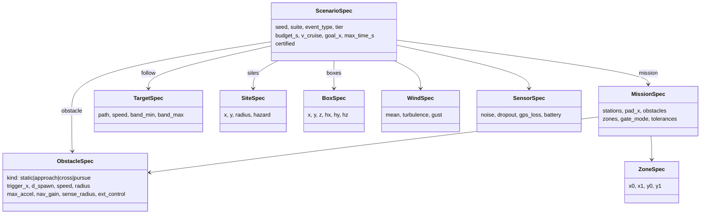

A scenario is a pure data model: `scenario_id` is a hash of its content, so identical specs are identical rows.

### Task families

| Family (`event_type`) | Drawer | Reference pilot (certifies it) | Task |
|---|---|---|---|
| obstacle benchmark (`obstacle_static`, `obstacle_approach`, `intruder_cross`, `battery_critical`, `gps_loss`) | `generator.py` | oracle | avoid one event; budget-first generation |
| `mission` | `missions.py` | `mission_fsm` | scan stations, dodge hazards, land |
| `follow` | `sims.draw_follow` | `follow_pilot` | keep a moving target in a range band |
| `delivery` | `sims.draw_delivery` | `zone_pilot` | reach the pad without entering no-fly zones |
| `pursuit` | `sims.draw_pursuit` | `oracle` | dodge a steering intruder |
| `landing` | `sims.draw_landing` | `site_best` | choose and reach a safe site as the battery dies |
| `gates` | `sims.draw_gates` | `gate_pilot` | fly through gates without stopping |
| `canyon` | `sims.draw_canyon` | `fsm` | cross a walled corridor with a gust |
| `orbs` | `sims.draw_orbs`, `draw_swarm`, `draw_orbs_random` | `orb_pilot` | dodge homing orbs, then land |

**Certification:** a generated scenario is kept only if its reference pilot succeeds at zero latency (`generate_family`, `generate_missions`, `ScenarioGenerator.generate_certified`). This guarantees "feasible in principle" and also biases the set toward what that pilot can solve, which is why a reference pilot's own success rate is not a result. The obstacle benchmark also builds *impossible controls* (budget below the oracle's reaction limit) to show that failures there are physical.

**Budget-first generation:** the obstacle benchmark draws the reaction budget *B* first, then places the event so the oracle can just meet it. The "tier" is derived from *B*.

## 10. Decision arms and providers

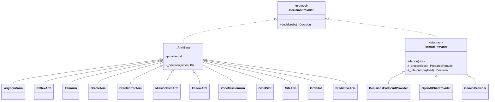

**Classical arms** (`controllers/arms.py`, `sim_arms.py`) compute from the observation in microseconds, so their latency is about 0. The **oracle** reads `TruthState` (`needs_truth`) and picks a safe action. `OracleErrorArm` replaces a fixed share of the oracle's decisions with random ones (the accuracy-by-latency study). `PredictiveArm` wraps a reflex arm and extrapolates range and time-to-collision by an expected latency.

**Remote providers** share `RemoteProvider`, a template method: build one request, send it on a persistent HTTP/2 client, parse, and **never raise** (an invalid `Decision` is returned instead; the harness owns fallback). It also owns timing (`perf_counter_ns`), the response cache and the budget ledger.

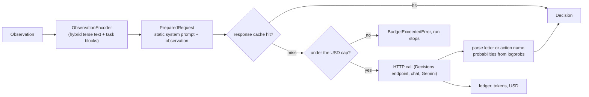

**Prompt design** (`encoding.py`, `prompts.py`): a ~550-token static system prompt (cache-friendly prefix) built from the action glossary, then the observation as a compact line block. Geometry is pre-digested into buckets (`lat=LEFT`, `gap=TOO_FAR`, `state=BLOCKED`) and each task appends a **rules paragraph** (`MISSION_RULES`, `GATE_RULES`, `FOLLOW_RULES`, `ZONE_RULES`, `LANDING_RULES`, `ORB_RULES`) that overrides the generic priority rules. The same encoder and glossary serve every model; models are not tuned individually.

`factory.build_provider(arm_config)` selects a provider by `provider` (`decisions_endpoint`, `openai_chat`, `openrouter_chat`, `gemini`, `mock`). Keys live in `.env` (`app/core/config.py`, pydantic-settings); `BUDGET_USD` (default 15) is a hard cap enforced by the ledger.

## 11. The experiment harness and SQLite store

An experiment is a YAML file validated by `app/schemas/experiment.py` and hashed (`sha`) into its manifest.

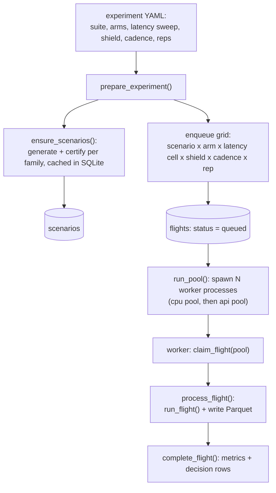

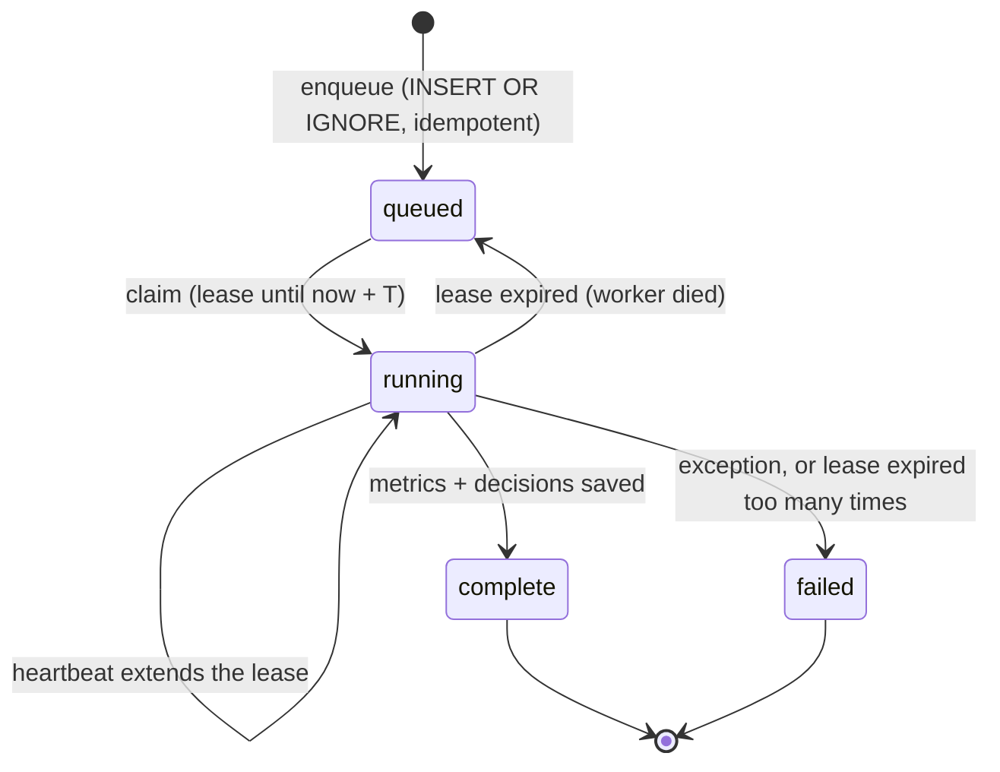

- **Idempotent:** the `UNIQUE (experiment, scenario, arm, latency mode, latency, shield, cadence, rep)` constraint means re-running a config only adds missing flights.
- **Pools:** classical arms run in the `cpu` pool (6 workers); API arms in the `api` pool (4 workers, bounded by rate limits and the budget cap).
- **Spawn, not fork:** workers use the `spawn` start method (PyBullet is not fork-safe). A consequence: scripts that start a pool must be real files with a `main()`, not stdin snippets.
- **Cells:** each arm flies fixed-latency cells (`latency_sweep_ms`), sampled cells (`latency_sampled_ms`) and/or one measured cell.

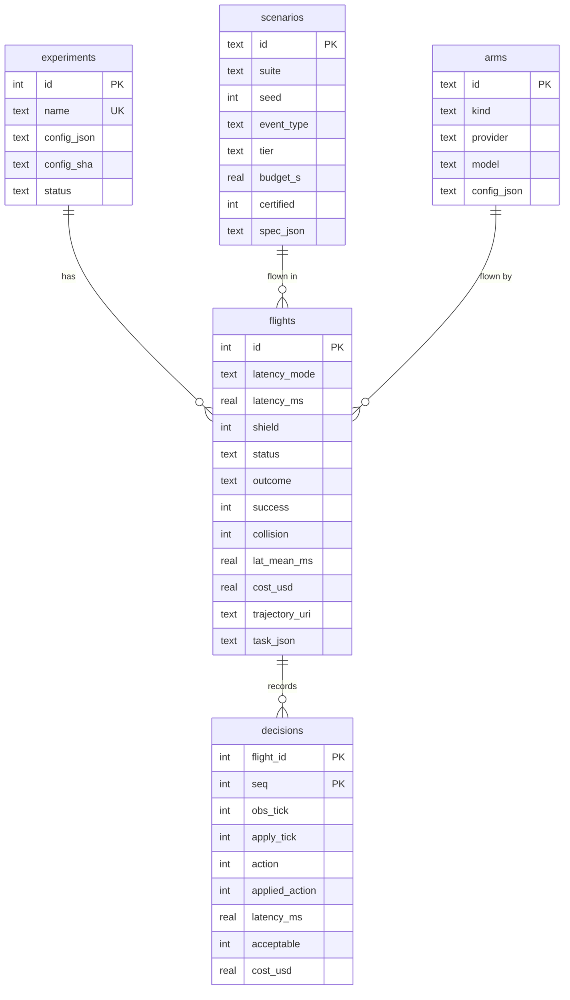

Also in the schema: `model_cache` (cached provider responses), `budget_ledger` (every paid call), `meta`. The database is `data/drone_jev.db` (WAL, STRICT tables); trajectories are `data/trajectories/<experiment>/<flight>.parquet`, one row per control tick, simulation time only.

## 12. Analysis, API and dashboard

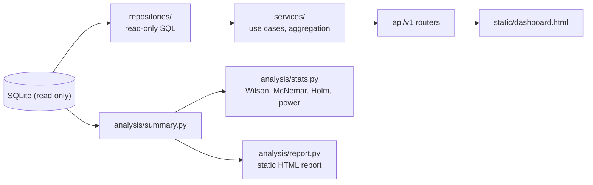

The API (`/api/v1`) is **read-only** (the engine opens the database with `mode=ro`): experiments and progress, results and latency curves, flights and decisions, flight replay (trajectory plus decisions), arms, scenarios and a server-sent-events stream of progress. Layering follows the coding guide: routers parse input and call a service; services call repositories; repositories own SQL.

`analysis/stats.py` implements the statistics the findings use: **paired** designs on scenario id, exact McNemar tests with a paired Wald interval, Holm correction, Wilson intervals, Wilcoxon, Kaplan-Meier and sample-size and power helpers. The studies' own analysers (`scripts/analyze_*.py`) reuse them.

## 13. Rendering and media

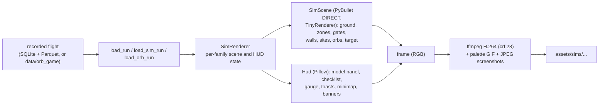

- Rendering is a **replay** of a recorded flight: nothing is simulated, the scene is rebuilt from the spec and the trajectory. The drone is drawn 4 to 6 times larger than real.
- `scene.py`/`MissionScene`: ground, drone, smoothed chase camera, projection. `sim_scene.py`/`SimScene` adds zones (red slabs and posts), gates (four-bar frames recoloured by status), walls, sites, the follow target and orbs (or rival-drone models for the chaser skin).
- `hud.py`: the heads-up display, generalised with a configurable checklist, a gauge with a target band, map rectangles and dots, and outcome banners.
- TinyRenderer ignores alpha, so translucent things (ghost rings) are drawn as projected 2D marks.
- `scripts/render_sims.py` and `render_orbs.py` compose multi-panel comparison videos on the **same scenario**, picking the median-ranked contrast case rather than the most dramatic one.

## 14. Special studies: two drones, inspection, Orb Dodge

### 14.1 Two drones (`app/sim/two_drone.py`, `scripts/run_two_drone.py`)

One PyBullet client with two drones (`Physics.PYB`; the downwash mode crashed a drone in a spike). Each has its own frame, executor, PID, provider and latency policy; the other drone appears as a disc return in the rays and in `Observation.extras`. The runner `run_pair` applies the same latency rule per drone. Output: a 5 x 5 latency grid, 100 seeds per cell.

### 14.2 Camera inspection (`app/sim/inspection.py`, `app/providers/vision.py`)

A wall of panels, some with seeded defects, painted at 64, 128 and 224 px; a vision client sends lossless PNGs to three models with a local spend cap; accuracy and latency are measured per size, with a text-only control. A demo flight composes the mission renderer with a camera picture-in-picture.

### 14.3 Orb Dodge (`app/harness/orb_control.py`, `scripts/run_orb_game.py`)

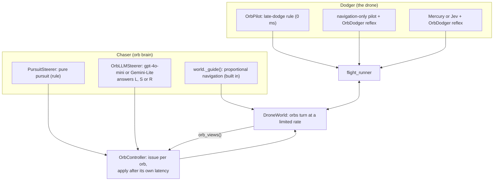

- Orbs are **kinematic** game objects (constant speed, a turn-rate limit); only the drone is simulated physics. `ObstacleSpec.ext_control` switches an orb from the built-in guidance to an external command in {-1, 0, +1}.
- `OrbController` runs the orb's decisions on the same simulation clock as the drone's: requests are issued per orb when none is in flight, and applied after that brain's latency (rule brains at 0 ms, language-model brains at their measured time).
- `OrbDodger` is the shared "dodge late" rule: orbs turn slowly, so a dodge begun early is out-turned; it triggers inside 0.9 m of radar range and commits to a side. The pilot uses it directly; for models it runs as a **zero-latency reflex layer** (when `shield` is set in an orb scenario, the forward-brake shield is disabled and the dodger takes over).
- Scenarios: `draw_orbs` (3 orbs), `draw_swarm` (6 in waves of 2), `draw_orbs_random` (2 to 5 orbs with random speed, turn rate and wind, uncertified). The runner records every orb's position in extra trajectory columns (`orb{k}x/y/z`).
- `scripts/run_orb_game.py` has parts A (rule sweeps), B (live fliers vs three chasers), C (role swap), S (swarms) and T (the tournament); flights are saved to `data/orb_game/` and summarised in `assets/sims/orbs/results.json`.

## 15. Scripts

| Script | Purpose |
|---|---|
| `setup_sim_env.sh` | Build the Python 3.14 environment and PyBullet (with the `fdopen` flag) |
| `run_experiment.py` | Prepare and run any experiment config end to end (`run_one`) |
| `run_live.py`, `run_missions.py` | Live-model runs under the budget cap (benchmark, mission audition) |
| `tune_arms.py` | Random-search the rule-based arms' thresholds on a held-out suite |
| `run_sims.py`, `run_sims_live.py` | The six rule-based sweeps and the live runs on four tasks |
| `run_human.py`, `run_ghost.py` | The human-like latency and the predictive-decision experiments |
| `run_two_drone.py`, `run_inspection_study.py` | The two-drone sweep; the camera study |
| `run_orb_game.py` | Orb Dodge parts A, B, C, S, T |
| `analyze_sims.py`, `analyze_sims_live.py`, `analyze_human.py`, `analyze_ghost.py`, `analyze_orb_tournament.py` | Tables, paired tests and charts |
| `render_mission.py`, `render_sims.py`, `render_orbs.py`, `render_two_drone.py`, `render_inspection.py` | Videos, GIFs and screenshots |
| `make_report.py`, `seed_demo_db.py`, `capture_docs_media.py` | Static reports, a demo database, README media capture (Playwright) |

Scripts use constants at the top rather than CLI arguments, add the repo root to `sys.path`, and log start, end and elapsed time (per the coding guide). Orb scripts take an environment variable (`ORB_PARTS`, `RENDER_CASES`, `RENDER_SLUGS`) to run a subset.

## 16. Tests

About 300 tests in `tests/unit/` (run with `.venv/bin/python -m pytest -q`; they take about 30 s).

| Area | Files |
|---|---|
| Contract and world | `test_sim_world.py`, `test_sim_mission.py`, `test_sim_tasks.py`, `test_sim_families.py`, `test_sim_extras.py` |
| Controllers | `test_controllers_executor.py`, `test_controllers_arms.py` |
| Scenarios | `test_scenarios_spec.py`, `test_scenarios_generator.py`, `test_missions.py` |
| Harness | `test_harness_latency.py`, `test_harness_runner.py`, `test_harness_store.py`, `test_harness_pipeline.py` |
| Providers | `test_providers_*.py` (encoding, parsing, cache and budget, factory, mock, remote with a mock transport) |
| Oracle and analysis | `test_oracle_labeller.py`, `test_analysis_*.py` |
| API and render | `test_api_endpoints.py`, `test_render_mission.py` |
| Studies | `test_two_drone.py`, `test_inspection.py`, `test_orbs.py` |

Conventions: unit tests mock providers and never touch the network; integration tests use a real PyBullet world (`tests/unit/conftest.py` provides a module-scoped `world`, one PyBullet world per test module); tests clean up after themselves. Quality gates: `ruff check`, `ruff format`, `mypy --explicit-package-bases` (pre-commit runs them on commit).

## 17. Design decisions and trade-offs

| Decision | Why | Cost |
|---|---|---|
| Latency applied on **simulation time** by the harness | The simulator never waits on a model; sweeps are fast and the same code serves injected and measured latency | Measured cells still run at wall-clock speed for the API calls |
| 11 discrete actions plus a PID | One interface for every decision-maker; LLM-friendly one-token answers | A sidestep is a fixed step; a continuous policy could do more |
| Hand-written carrot executor | The stock PID is unstable above ~3 m/s² lateral; the carrot makes actions predictable | The dodge is slow, which bounds every task's difficulty |
| Certified scenarios | A failure means "too slow", not "impossible" | Biases scenarios toward what the reference pilot can solve |
| Paired designs and exact tests | Small samples need paired power; every cell flies the same scenarios | Cells must share scenarios (hence seed-keyed pairing across suites) |
| SQLite WAL plus Parquet | No server, easy to inspect, resumable, queryable | One writer at a time (fine at this scale) |
| `spawn` workers | PyBullet is not fork-safe | Scripts must be importable files |
| Read-only API | The dashboard can never corrupt a running experiment | No write endpoints |
| Replay-only rendering | Decouples video from simulation; deterministic | Re-render needed when visuals change |
| Kinematic orbs, analytic radar | Keeps the game playable and the sensing honest about its approximation | Not physically faithful; the docs say so |
| Task blocks and rules in the prompt | Models are weak at raw numbers and need the task spelled out | The prompt is one fixed design, not tuned per model |
| One shield flag, three meanings | Reuse the same condition axis for brake shield, zone geofence and orb reflex | The meaning depends on the task family |

**Gotchas for contributors**
- Editing generated code with scripted `str.replace` silently fails after `ruff format` re-wraps lines; verify with `grep` or edit by line.
- BSD `sed -i` needs a backup suffix on macOS.
- `pre-commit` hooks reformat files, so a commit may need to be run twice.
- Do not commit while another process is mid-writing files under `assets/` or `docs/`.

## 18. How to extend it

**A new rule-based arm.** Subclass `_ArmBase` in `controllers/sim_arms.py` (or `arms.py`), implement `decide(obs) -> Decision`, register it in `build_classical_arm`, and reference it by `kind` in an experiment YAML.

**A new LLM provider.** Subclass `RemoteProvider` (`providers/base.py`): `_prepare` builds the request, `_interpret` turns the payload into a `Decision`. Register it in `providers/factory.py`, add its key to `core/config.py` and `.env.sample`.

**A new task family.**
1. Add a drawer to `scenarios/sims.py` and register it in `DRAWERS` and in `SuiteCfg.kind` (`schemas/experiment.py`), `EventType` (`scenarios/spec.py`) and `FAMILY_PILOTS` (`harness/experiment.py`).
2. If it needs world content (a new obstacle or object), extend `sim/world.py`; if it needs scoring, add a tracker in `sim/tasks.py` and wire it in `flight_runner.py` (extras, termination, success).
3. Write the reference pilot so the family can be certified.
4. Add a prompt block and rules to `providers/encoding.py` if models are to fly it.
5. Add a renderer branch in `render/sim_video.py` (`family_of`, `_fill_family`) and scene content in `render/sim_scene.py`.
6. Add tests, then an experiment YAML and an analyser.

**A new experiment.** Write a YAML under `configs/experiments/` (suite, arms, `latency_sweep_ms`, `shield`), then run it with `scripts/run_experiment.py` (or a small script that calls `run_one`). Results appear in the database, the dashboard and `scripts/make_report.py`.

**Rules of thumb that save time:** keep every new scenario deterministic in its seed; certify before you measure; compare arms on the same scenario ids; report intervals and paired tests; and write the prediction down before you look at the data.
