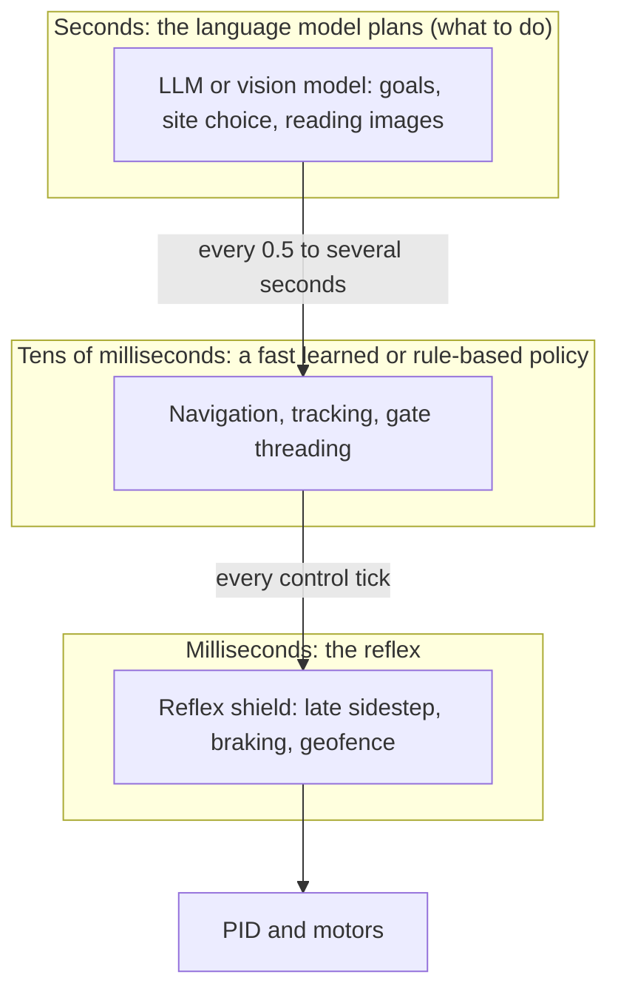

# Findings across every simulation

This is the consolidated read-out of everything measured in this repository: the injected-latency benchmark, the live-model runs, the mission demo, the ten Group A simulations, the Orb Dodge game and its tournament. It compares **LLM decision models**, **hand-written rule-based pilots** and a **privileged oracle** on the same scenarios, and ends with a comment on AI against rule-based against traditional machine learning.

Companion documents: [SIMULATIONS.md](SIMULATIONS.md) (the ten simulations in detail), [sims/orbs.md](sims/orbs.md), [LIVE-RESULTS.md](LIVE-RESULTS.md), [MISSION-DEMO.md](MISSION-DEMO.md), [ARCHITECTURE.md](ARCHITECTURE.md) (how it is built).

> **Read this first.** Everything is **simulation** (a 27 g Crazyflie-class quadrotor in PyBullet). Sample sizes are small (12 to 60 scenarios per cell, 8 in several live cells). Latency is injected on simulation time or taken from wall-clock calls from one location (India). Thresholds, geometry and rule-based pilots were tuned until the zero-latency pilot succeeded, so *where* things break is specific to those choices. **Traditional machine learning (reinforcement learning, MPC, a trained neural controller) was never run here**; what I say about it in the last section is inference from these results, not a measurement.

## Contents

1. [The short version](#1-the-short-version)
2. [What was run](#2-what-was-run)
3. [Finding 1: decision latency is the dominant variable](#3-finding-1-decision-latency-is-the-dominant-variable)
4. [Finding 2: how much latency each task tolerates](#4-finding-2-how-much-latency-each-task-tolerates)
5. [Finding 3: rule-based vs LLM vs oracle on every task](#5-finding-3-rule-based-vs-llm-vs-oracle-on-every-task)
6. [Finding 4: which LLM, and what separates them](#6-finding-4-which-llm-and-what-separates-them)
7. [Finding 5: mitigations that did and did not work](#7-finding-5-mitigations-that-did-and-did-not-work)
8. [Finding 6: multi-agent and adversarial settings](#8-finding-6-multi-agent-and-adversarial-settings)
9. [Where the LLM earned its place](#9-where-the-llm-earned-its-place)
10. [Predictions: scorecard](#10-predictions-scorecard)
11. [Threats to validity](#11-threats-to-validity)
12. [Comment: AI vs rule-based vs traditional ML](#12-comment-ai-vs-rule-based-vs-traditional-ml)

---

## 1. The short version

1. **Latency decides almost everything.** Across eleven different tasks, performance is set far more by how long a decision takes than by how good it is. A perfect decision that arrives 300 ms late loses most of the tasks where a rule-based decision at 0 ms wins.
2. **A hand-written rule-based pilot beat every LLM in every flight task I tested**, usually by a wide margin and always with the advantage of about 0 ms decision time. The one exception is a tie in follow-me, where one model (Mercury Decide) matched the rule-based pilot's 12 of 12.
3. **LLMs differ mainly by speed, not by judgement.** In the live benchmark every model chose an acceptable action 92 to 96% of the time; collisions rose in the order of measured latency.
4. **A fast reflex layer matters more than which model sits above it.** With a reflex shield on, five different models landed within 12 to 27% collisions and could not be told apart.
5. **Most clever mitigations did nothing.** Telling a rule the expected latency and extrapolating (A6) recovered about 0% of the penalty.
6. **LLMs did something rules cannot only where perception is the task** (reading a camera frame to decide whether a wall panel is cracked), and even there a text-only control scored as well as the image.
7. **Four of my eleven written predictions held** (5 falsified, 2 in part) for the ten simulations; the orb work was exploratory and had none.

## 2. What was run

| Study | What | Scale | Cost | Doc |
|---|---|---|---|---|
| Injected-latency benchmark | Oracle and rule-based arms across 0 to 2000 ms, shield off and on | about 13,000 flights | $0 | [README](../README.md#results) |
| Accuracy x latency | The oracle with 0 to 40% random errors across the sweep | 120 scenarios x 8 latencies x 4 arms | $0 | below |
| Live model benchmark | Jev, Mercury, GPT-4o-mini, Gemini 3.5 Flash-Lite, GPT-6 Luna vs rules and oracle | 60 scenarios, 960 flights, 6,891 calls | $0.45 | [LIVE-RESULTS.md](LIVE-RESULTS.md) |
| Mission audition | Four live models flying 12 multi-step missions | 12 missions x 10 cells | $0.28 | [MISSION-DEMO.md](MISSION-DEMO.md) |
| A1 to A4, A8, A9 | Follow-me, delivery with zones, steering intruder, landing-site choice, gates, canyon | 24 scenarios per cell | $0 | [SIMULATIONS.md](SIMULATIONS.md) |
| A1 to A4 live | Live models on follow, gates, landing, delivery | 12 scenarios, 4 models | $0.72 | [SIMULATIONS.md](SIMULATIONS.md#live-models-on-the-tasks) |
| A5 human baseline | The FSM rule with a synthetic human reaction time vs Jev | 56 scenarios | $0 | [SIMULATIONS.md](SIMULATIONS.md#a5-human-vs-jev-vs-reflex) |
| A6 predictive decisions | Extrapolating by the expected latency | 56 + 24 scenarios | $0 | [SIMULATIONS.md](SIMULATIONS.md#a6-ghost-drone-predictive-decisions) |
| A7 two drones | Each drone with its own latency | 8,800 flights | $0 | [sims/two-drone.md](sims/two-drone.md) |
| A10 camera inspection | Three vision models, three image sizes | 720 scored calls | $0.10 | [sims/inspection.md](sims/inspection.md) |
| Orb Dodge | Homing orbs, swarms, role swaps, rule or model on either side, randomised tournament | about 700 flights | about $0.28 | [sims/orbs.md](sims/orbs.md) |

Total live-API spend across all studies is about **$1.8** (the sum of the figures above; Gemini is not priced in this project, so that part is understated).

## 3. Finding 1: decision latency is the dominant variable

**The benchmark curve.** The privileged oracle (it knows ground truth and always picks a safe action) collides more and more as its decision is delayed. 130 certified scenarios:

| decision latency | 0 ms | 50 | 100 | 200 | 300 | 500 | 1000 | 2000 |
|---|---|---|---|---|---|---|---|---|
| collisions, shield off | 0% | 0% | 7% | 42% | 54% | 68% | 81% | 99% |
| collisions, shield on | 0% | 0% | 2% | 5% | 7% | 13% | 23% | 39% |

The knee is at 100 to 200 ms. The decision is perfect; only its timing changes.

**Speed against accuracy.** The same oracle with a fixed share of random wrong decisions (120 scenarios, shield off), collision rate:

| latency | perfect | 10% errors | 20% errors | 40% errors |
|---|---|---|---|---|
| 0 ms | 0% | 2% | 1% | 5% |
| 100 ms | 6% | 8% | 6% | 7% |
| 300 ms | 44% | 33% | 26% | 17% |
| 1000 ms | 66% | 51% | 44% | 33% |

Two readings. First, **at 0 to 100 ms accuracy is what matters** (a 40% error rate costs 5 points) and **from 200 ms upward the error rate barely matters because the delay already costs far more**. Second, the table has an artifact I want to flag: at high latency the *less accurate* oracle looks better. The errors are random substitutions, and a random action sometimes happens to sidestep early; this is not evidence that errors help, and I would not quote it.

**What it means for the LLMs.** The models run at about 500 to 1000 ms per decision, which is past the knee for every task that needs a reaction, so most of their collisions are the latency curve, not mistakes.

## 4. Finding 2: how much latency each task tolerates

The latency at which a task first breaks, for the zero-latency rule-based or oracle pilot. All injected-latency sweeps; "n" is scenarios per cell.

| Task | Healthy up to | Broken by | Shape |
|---|---|---|---|
| Gate slalom (A8) | 100 ms (24/24) | 200 ms (0/24) | a cliff; the most latency-sensitive task |
| Homing orbs (Orb Dodge) | 0 ms (24/24, certified) | 300 ms (0/24) | a cliff (100 and 200 ms were not sampled) |
| Steering intruder (A3) | 0 ms (24/24) | 100 ms (16/24); 9/24 at 300 ms | a steady slide, with a straight intruder far milder (22/24 at 800 ms) |
| Plain obstacle (benchmark) | 50 ms | 200 ms (42% collisions) | knee at 100 to 200 ms |
| Follow-me (A1) | 300 ms (24/24) | 1000 ms (14/24); 1500 ms (8/24) | smooth; weaving targets fail first (3 of 12 at 1 s) |
| Landing-site choice (A4) | 600 ms (24/24) | 1000 ms (6/24) | cliff between 0.6 and 1.0 s |
| Delivery, zone-aware (A2) | 600 ms (24/24) | 1000 ms (0/24) | a cliff, and it is the pad overshoot that fails |
| Canyon, gust only (A9) | 1000 ms (15/15) | not broken | flat: the PID handles the gust |
| Canyon, block ahead (A9) | 0 ms (9/9) | 100 ms (1/9) | non-monotonic; 9 scenarios only |
| Two drones (A7) | (300, 300) ms: 0% collisions, 40% near misses | (600, 600) ms: 45% collisions | set by the **faster** drone |

**Rule of thumb that fits the table:** a task tolerates about as much latency as it has *reaction slack*. Tasks whose answer is "keep doing this" (a gust, a straight target, a far landing site) tolerate 600 to 1000 ms or more. Tasks that need a precise correction while something closes (a gate window, a homing orb, a steering intruder, a plain obstacle) break at 100 to 300 ms. The live models' 500 to 1000 ms is inside the tolerant group and outside the sensitive one.

## 5. Finding 3: rule-based vs LLM vs oracle on every task

One row per task. "Rule" is the zero-latency hand-written pilot for that task; the models are the live LLMs at their own measured latency (about 500 to 1000 ms). Same scenarios for every column inside a row.

| Task | Rule-based | Best LLM | Other LLMs | Oracle | Metric (n) |
|---|---|---|---|---|---|
| Obstacle benchmark, no shield | **9%** (tuned FSM and reflex) | Jev 43%, Mercury 45% | GPT-4o-mini 61%, Gemini 66%, Luna 71% | 0% | collisions (56) |
| Obstacle benchmark, shield on | 9 to 11% | Mercury 12%, Luna 12% | Jev 18%, GPT-4o-mini 16%, Gemini 27% | 0% | collisions (56) |
| Multi-step mission (stations, hazards, pad) | **12/12** | Mercury + shield 5/12 | Jev + shield 4/12, Gemini 0/12, GPT-4o-mini 0/12 | n/a | missions completed (12) |
| Follow-me (A1) | 12/12 | **Mercury 12/12** | Jev 8/12, Gemini 3/12, GPT-4o-mini 0/12 | n/a | completed in band (12) |
| Gate slalom (A8) | **12/12** | 0/12 for all four | | n/a | all gates (12) |
| Engine-out landing (A4) | **12/12** | Gemini 4/12 | Mercury 2, GPT-4o-mini 2, Jev 0 | n/a | safe landing (12) |
| Delivery, no-fly zones (A2) | **12/12** | Mercury 2/12 | Jev 1, GPT-4o-mini 1, Gemini 0 | n/a | landed and never in a zone (12) |
| Orb Dodge tournament | **24/48** (rule pilot) | Mercury 7/48 | Jev 4/48; rule nav + reflex 15/48 | n/a | survived (4 chasers x 12) |
| Camera inspection (A10) | not applicable (needs perception) | GPT-4o-mini 0.95 at 128 px | GPT-6 Luna 0.93, Gemini 0.60 to 0.67 | n/a | accuracy (60 stills) |

What the table says:

- **The rule-based pilot wins or ties every flight task.** The margins range from modest (obstacle benchmark: 9% against 43%) to total (gates: 12 against 0).
- **The only tie is follow-me, and it is not a decision-quality tie.** Mercury (508 ms) completed 12 of 12 but with a lower time in band (0.90 against 1.00); follow-me is among the most latency-tolerant tasks (straight targets survive 1000 ms). Jev has the same latency and managed 8 of 12, so latency is not the whole story there.
- **Tasks that need no reaction are where LLMs are closest.** Follow-me, landing-site choice and delivery all involve some reasoning about what to do (where to land, which side of a zone), and the LLMs are least bad there, but only follow-me is competitive.
- **The oracle is the ceiling, not a competitor.** It knows ground truth and is the reference every scenario is certified against.

## 6. Finding 4: which LLM, and what separates them

**Speed ordered the models in the benchmark, not judgement.** Every model's action matched the labeller's acceptable set 92 to 96% of the time, and collisions followed measured latency: Jev (601 ms) 43%, Mercury (611 ms) 45%, GPT-4o-mini (718 ms) 61%, Gemini (976 ms) 66%, Luna (1080 ms) 71%. Jev beat Luna, Gemini and GPT-4o-mini (paired McNemar, Holm-adjusted p = 0.0006, 0.007, 0.04) and tied Mercury.

**Across the later tasks the picture is noisier and mostly not significant.** Mercury and Jev have the same latency and traded places: Mercury 12 of 12 against Jev 8 of 12 on follow-me (paired p = 0.125), Jev slightly ahead without the shield (43% against 45% collisions) and Mercury slightly ahead with it (12% against 18%) in the benchmark. In the orb tournament they are indistinguishable (7 and 4 of 48, p = 0.55). The fast pair (Jev, Mercury) was at or ahead of the slower models almost everywhere, but I could not show a significant Jev-over-Mercury or Mercury-over-Jev ordering anywhere.

**Latency tails matter more than medians** (benchmark): Mercury's p95 was 1.03 s against Jev's 0.73 s at the same median, and a 1.2 s p99 is a long time at 2 m/s. At n = 56 it did not separate them in collisions.

**Instruction following mattered more in the multi-step mission.** GPT-4o-mini never issued `HOVER`, so it never stopped to scan, and flew out of the arena on every mission; Gemini was slow and collided. Jev and Mercury followed the rules.

## 7. Finding 5: mitigations that did and did not work

| Idea | Result | Where |
|---|---|---|
| **A reflex layer under the model** | **Worked.** Models went from 43 to 71% collisions to 12 to 27%; five models became indistinguishable. | benchmark |
| A zero-latency dodge reflex in the orb game | Helped: a navigation-only pilot with the reflex survived 4 and 3 of 24 at 300 and 600 ms against homing orbs, where the full pilot survived 0 of 24; but it did not fix it (10 of 24 even at 0 ms) | Orb Dodge |
| Extrapolating by the expected latency (A6) | **Did not work**: about 0% recovered at 200 and 400 ms, about 12% at 700 ms, none significant | A6 |
| A geofence layer for zones (A2) | Mixed: it hurt at 600 ms (24 to 17), helped at 1000 ms (0 to 9), and made the zone-blind pilot safe but unable to deliver | A2 |
| Bigger images for the vision model (A10) | No gain past 128 px for two of three models; only 35 to 53 ms of extra latency | A10 |
| Slower orb brain | Mildly helps the dodger (10 to 16 survivals of 24 from 0 to 1000 ms chaser latency, p = 0.15) | Orb Dodge |
| **Slack** (more reaction budget) | **The currency.** With 1 to 2 s of slack Jev collided 16% against 68% for Luna; below 1 s nobody coped | benchmark |

Extrapolation fails because it moves the decision earlier in the rule's mind but gives it no more time, and the collisions that remain are the ones whose reaction budget is shorter than the latency (12 of 31 at 700 ms). **Information cannot be created by prediction; only speed or slack helps.**

## 8. Finding 6: multi-agent and adversarial settings

- **Two drones (A7):** collision risk follows the *faster* drone, not the sum of the two latencies (equal-sum cells: 0% asymmetric against 41 to 45% symmetric). No deadlocks in 8,800 flights. The other drone was sensed only within 2 m by my choice, so the latency where collisions start is set by that choice.
- **Chaser against dodger (Orb Dodge):** a **rule-based chaser (homing 60%, pursuit 50% hits) beat a language-model chaser (gpt-4o-mini 23%, Gemini-Lite 35%)**, clearly for gpt-4o-mini (adjusted p = 0.002 and 0.02). The small model decides in 0.7 to 1.0 s against a dodger that reacts in a fraction of that.
- **Latency hurts both sides:** the same slowness that makes a model a poor flier makes it a poor chaser. A slower chaser does help the dodger a little.
- **Roles are not symmetric.** The rule-based dodge pilot survives about half of all randomised scenarios whoever chases; the models' dodgers survive 8 to 15%.
- **A swarm overwhelms everything with latency.** Six orbs in waves of two: the rule pilot survives only the winnable 13% at 0 ms by construction, 0 of 24 at 300 ms, and no model-flown flight survived (0 of 8, twice).

## 9. Where the LLM earned its place

1. **Perception and open-ended judgement.** The camera inspection is the one task in the set that a hand-written rule could not do without a detector: telling a cracked wall panel from a clean one in a picture. gpt-4o-mini reached 0.95 accuracy at 128 px. The control that replaced the picture with a neutral written description was *at least as accurate* (0.98 for gpt-4o-mini, 1.00 for Luna), so the value here was reading a description or an image, not flying.
2. **Choosing what to do when the choice is not reactive.** Follow-me and, to a lesser extent, landing-site choice and zone avoidance are the tasks where models came closest to rules, because the decision is a plan rather than a reflex.
3. **Fast to build, with a bounded cost.** The rule-based pilots took many iterations of tuning and several rewrites (the orb pilot failed repeatedly before it worked); the LLM arms only needed a prompt block. Running every live study cost about $1.8 in total.
4. **No tuning required to work at all.** The models were never tuned for these tasks, and still reached 12 to 27% collisions in the benchmark with a reflex under them.

## 10. Predictions: scorecard

Predictions were written before the data (see [SIMULATION-IDEAS.md](SIMULATION-IDEAS.md)). Held means the data agreed.

| Sim | Prediction | Verdict |
|---|---|---|
| A1 follow-me | Error is at least 1.5 x v x L | Falsified (about 0.6 x) |
| A2 delivery | Breach depth rises about linearly with latency | Falsified (no graded signal) |
| A3 steering intruder | Collapses at least 2x earlier than a straight one | **Held** |
| A4 landing | "Nearest" overtakes "best" at some latency | **Held** (1.0 to 1.5 s) |
| A5 human | A 250 ms human sits nearer the rule than Jev | **Held** |
| A6 ghost drone | Extrapolation recovers at least half | Falsified |
| A7 two drones (a) | Risk depends on L_A + L_B | Falsified |
| A7 two drones (b) | Symmetric drones deadlock at least 10% | Falsified |
| A8 gates | Falls from 100% to 0% between 0.2 and 0.8 s | Partly (it is at 0.1 to 0.2 s) |
| A9 canyon | Latency does not matter for gusts | **Held**, but weakly |
| A10 camera | Accuracy saturates near 128 px, latency keeps rising | Partly |

**Four of eleven held.** My model of what would be easy was wrong in more cases than right, which is a reason to measure rather than assume.

## 11. Threats to validity

- **Simulation only**, a tiny quadrotor, a PID tuned for gentle manoeuvres (lateral accelerations above about 3 m/s² destabilise it, so every dodge is slow).
- **Small samples.** 24 scenarios per sweep cell, 12 for live cells, 8 for several; a cell of 12 has a 95% interval about 0.3 wide at best. Differences under about 20 points are not resolved, and many comparisons are unadjusted.
- **Certification bias.** Every scenario was certified completable by the task's own rule-based pilot, so the rule-based pilot's "24 of 24" is by construction and the scenarios favour rule-solvable ones.
- **Rule pilots are tuned, and tuned to the task.** A fair comparison would give a model equal tuning effort (a better prompt, examples, fine-tuning); the models got one fixed prompt each.
- **Latency is from one place.** India to US-hosted endpoints; elsewhere the models are faster (Jev publishes 200 to 330 ms), and the gaps shrink.
- **Modelling choices drive the knees.** Radar range, orb speed, gate tolerance, zone size and the 11-action interface all set where tasks break. The structure of the results is more trustworthy than any single threshold.
- **The 11-action interface limits what a model can express**, and a sidestep is a fixed 1 to 1.2 m step; a continuous-control policy could do things the interface forbids.
- **Orb physics is not real physics**: orbs are kinematic, so the "physics" applies to the drone only.
- **No real hardware.** Nothing here is a claim about a real drone.

## 12. Comment: AI vs rule-based vs traditional ML

### What the evidence supports

**1. For reactive control, a few lines of rules beat LLMs, and the reason is latency, not intelligence.** The rule-based pilot beat the LLMs in every reactive task (obstacles, gates, orbs, intruders). It was not smarter: the models chose acceptable actions 92 to 96% of the time. It was *faster by two to three orders of magnitude* (about 0 ms against 500 to 1000 ms). Add a reflex layer under the model and the gap largely closes, which says the reflex, not the model, is doing the safety work.

**2. The LLM is better matched to decisions that are not time-critical.** Follow-me with a straight target, choosing a landing site with seconds to spare and reading an inspection image all tolerate half a second of thought. That is where I would put a language model: above a fast reflex layer, deciding *what* to do rather than *when to dodge*.

**3. Accuracy matters at the fast end, speed at the slow end.** The accuracy-by-latency experiment shows a perfect decision at 300 ms collides 44% of the time; a 20%-error decision at 0 ms collides 1%. If you can only improve one thing, make the decision fast first.

**4. The "AI" label hides large differences between models.** Within the LLMs, speed (Jev, Mercury) and instruction following (GPT-4o-mini failing to hold still) mattered more than any general measure of capability.

**5. Rules are not free.** The rule-based pilots were not trivially correct: the orb pilot needed a radar, a late-dodge trigger, a committed side and lane holding before it won half the scenarios; the gate and zone pilots were rewritten after infeasible first versions. A rule that wins at 0 ms still has to be written, tuned and re-tuned per task, and it wins only the tasks it was written for.

### What the evidence does not support (traditional ML)

**I did not test traditional machine learning.** There is no reinforcement-learning policy, no model-predictive controller, no trained network in this repository; the [master plan](MASTER-PLAN.md) lists them as not built. Anything below is inference, offered as a hypothesis to test:

- **A learned or optimised controller running onboard would sit at the left edge of the latency curve**, with a decision time in milliseconds, like the rule-based pilots. The latency finding says that is the position that wins the reactive tasks. Whether it would also *outperform* the tuned rules is not something these results can answer.
- **The proxy I do have is the accuracy-by-latency experiment**, which stands in for an imperfect-but-fast policy: an 80%-accurate decision at 0 to 100 ms collided 1 to 6%, far better than a perfect decision at 300 ms. That suggests a fast, imperfect learned policy would beat a slow, perfect LLM on reactive tasks, but a random-error oracle is a weak stand-in for a real trained model, which fails in structured ways rather than randomly.
- **A learned controller would have costs these simulations do not show**: training data and simulators, brittleness outside the training distribution, retraining per task, and weak interpretability. The rule-based pilots were quick to inspect and fix because their logic is readable; I would expect that to count in their favour in practice.
- **An LLM brings generality that neither rules nor a task-trained policy has**: it was prompted for gates, zones, landing sites and following with a paragraph each. That flexibility is real, and I measured its price: a decision time that is too slow for the reactive end of the task range.

### How I would combine them

The results point to a layered design rather than a winner:

Each layer gets the decisions whose slack matches its speed. This repository contains the top and bottom of that stack (an LLM layer and a rule-based reflex) and shows that the bottom layer decides most of the safety outcome; it does not contain the middle layer, and testing a trained policy there is the most useful next experiment.

### Bottom line

- **Use rules (or a fast controller) for anything with less than about 0.5 s of slack.** In this simulator that includes every reaction task I tried.
- **Use an LLM for decisions that can wait**, and always put a fast reflex under it.
- **Do not judge an LLM by its action accuracy**; in this study every model scored 92 to 96% and the real separator was how long it took.
- **Treat any claim about machine-learned controllers as untested here.** The evidence points to speed as what they would bring, but the experiment that would show it has not been run.
