# Simulations: ten new tasks, each tested against a written prediction

The benchmark asks how fast a decision layer must be. These ten simulations (Group A of [SIMULATION-IDEAS.md](SIMULATION-IDEAS.md)) turn that into tasks you can watch: follow a moving target, deliver around no-fly zones, dodge an intruder that steers into you, pick a landing site with the engine out, fly through gates, cross a canyon with gusts, race a human, predict where things will be, share airspace with another drone, and inspect a structure with a camera.

Each one was run against a prediction written **before** the data. Of the eleven predictions below, **only four held**, five were falsified and two held in part. That is a result in itself, and the table says which is which.

Everything here is simulation only (a 27 g Crazyflie model in PyBullet). Latency is injected on simulation time: a decision requested at control tick *t* is applied at *t + ⌈L/dt⌉* (48 Hz control), and the previous action stays in force meanwhile. Rule-based pilots are the zero-latency references; each scenario was certified completable by its pilot at 0 ms before it was used.

## Summary

| # | Simulation | What the video shows | Prediction | Verdict |
|---|---|---|---|---|
| A1 | [Follow-me](#a1-follow-me) | The drone trails a weaving target; a tether goes red when it falls out of range | Tracking error ≥ 1.5 × v × L | **Falsified** (error grew ≈ 0.6 × v × L) |
| A2 | [Delivery, no-fly zones](#a2-delivery-with-no-fly-zones) | Red zones on the way to the pad; a zone-aware and a zone-blind pilot | Breach depth rises about linearly with latency | **Falsified** (no graded signal; the aware pilot never breaches, it fails by overshooting the pad) |
| A3 | [Steering intruder](#a3-an-intruder-that-steers-into-you) | The same latency against a straight and a steering intruder | Success collapses ≥ 2× earlier than for a straight intruder | **Held** (the steering intruder is already at 67% at 100 ms; the straight one stays above 88% to 1200 ms) |
| A4 | [Engine-out landing](#a4-engine-out-landing-site-choice) | Battery bar drops; three sites, one a hazard | A latency exists above which "nearest" beats "best" | **Held** (between 1.0 and 1.5 s; p = 0.016 at 1.5 s, unadjusted) |
| A5 | [Human vs Jev vs reflex](#a5-human-vs-jev-vs-reflex) | Three panels on one scenario | A 250 ms human sits nearer the 0 ms rule than Jev | **Held** |
| A6 | [Ghost drone (prediction)](#a6-ghost-drone-predictive-decisions) | Rings where the drone and obstacle will be when the answer lands | Extrapolation recovers ≥ 50% of the gap for constant-velocity hazards | **Falsified** (recovers about 0%) |
| A7 | [Two drones](sims/two-drone.md) | Two drones negotiate a crossing | (a) Risk depends on L_A + L_B; (b) symmetric drones deadlock ≥ 10% | **Both falsified** (the faster drone sets the risk; 0 deadlocks in 8,800 flights) |
| A8 | [Gate slalom](#a8-gate-slalom) | Rings turn green as they are passed, orange when missed | Pass rate falls from ~100% to ~0% between 0.2 and 0.8 s | **Partly** (the cliff is real but at 0.1 to 0.2 s, earlier than predicted) |
| A9 | [Urban canyon](#a9-urban-canyon-with-gusts) | A gust shoves the drone toward a wall | Latency does not matter for pure gust rejection | **Held**, but weakly (see caveat) |
| A10 | [Inspection with a camera](sims/inspection.md) | Picture-in-picture of what the drone sees | Accuracy saturates near 128 px while latency keeps rising | **Partly** (saturation held for two of three models; the latency rise is only 35 to 53 ms) |

A7 has two predictions and A10 one; their details are in their own write-ups.

## Method, in one paragraph

Per task: 24 certified scenarios (12 for the live runs), each flown by a rule-based pilot at injected latencies, shield off unless stated. Success rates carry exact (Wilson) intervals where shown; comparisons are paired by scenario and use the exact McNemar test. P-values below are **unadjusted** unless marked; with six latencies per comparison, treat anything above p ≈ 0.01 as suggestive. The videos are side-by-side replays of two recorded flights on the *same* scenario, chosen as the median-ranked scenario in which one side succeeded and the other failed, so they show a typical contrast, not the most dramatic one. The drone is drawn 4× larger than real.

---

## A1. Follow-me

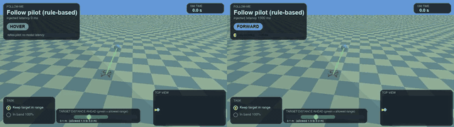

*Left: the follow pilot with no latency. Right: the same pilot at 1500 ms on the same weaving target. The tether is green while the target is inside the allowed range band and red when it is not.* Video: [compare.mp4](../assets/sims/follow/compare.mp4).

**Task.** Keep a moving target 1.5 to 5 m ahead and within 1.2 m sideways for 30 s without passing it. The target weaves, goes straight, or stops and goes. A flight succeeds if it completes with the target in the band at least 70% of the time. The drone has 11 discrete actions only (lateral moves are 1.5 m/s sidesteps), which is the point.

| latency | success (of 24) | time in band | mean range error | lost / overran |
|---|---|---|---|---|
| 0 ms | 24 | 1.00 | 0.23 m | 0 / 0 |
| 100 ms | 24 | 1.00 | 0.27 m | 0 / 0 |
| 300 ms | 24 | 0.99 | 0.39 m | 0 / 0 |
| 600 ms | 23 | 0.88 | 0.62 m | 0 / 0 |
| 1000 ms | 14 | 0.81 | 0.79 m | 9 / 1 |
| 1500 ms | 8 | 0.74 | 1.01 m | 14 / 2 |

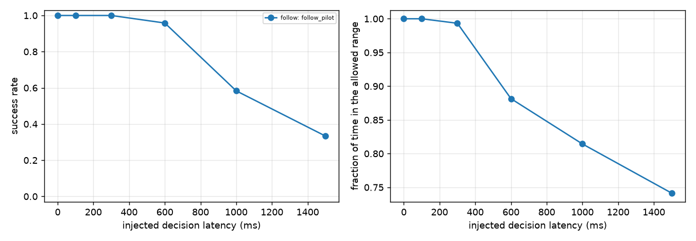

**Prediction: error ≥ 1.5 × v × L plus a floor. Falsified.** Mean target speed was 0.87 m/s. The error above its 0 ms value (0.23 m) grew by 0.04, 0.16, 0.39, 0.56 and 0.78 m at 100 to 1500 ms, against v × L of 0.09, 0.26, 0.52, 0.87 and 1.31 m: about 0.6 × v × L, not 1.5 ×. The pilot's forward action is not rigidly tied to target speed, so range error accumulates more slowly than the naive lag.

**What actually fails is lateral tracking, not range.** By target type at 1000 ms: straight 7 of 7, stop-and-go 4 of 5, **weaving 3 of 12** (at 0 ms: 7, 5 and 12 of 12). A weaving target moves sideways faster than a 1.5 m/s sidestep that arrives a second late can follow, so the lock is lost.

## A2. Delivery with no-fly zones

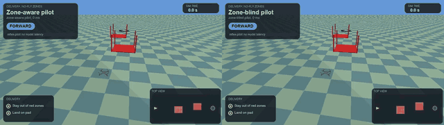

*Left: a pilot that sidesteps the red zones. Right: a pilot that flies straight for the pad. Both at 0 ms; the checklist shows the breach.* Video: [compare.mp4](../assets/sims/delivery/compare.mp4).

**Task.** Fly to a pad past two 2 × 1.9 m no-fly zones that overlap the straight path (each reaches 0.5 m past the centre line, on opposite sides), then land. **A delivery counts as a success only if it lands on the pad and never enters a zone by more than 2 cm.** (I first defined success as landing alone; the zone-blind pilot then "succeeded" 24 of 24 by flying through the zones, so I tightened the definition and recomputed the stored results; the unit test `test_delivery_that_enters_a_zone_is_not_a_success` pins it.) The shield flag acts here as a **geofence layer**: it predicts a breach and brakes.

| pilot | geofence | 0 ms | 300 ms | 600 ms | 1000 ms | 2000 ms |
|---|---|---|---|---|---|---|
| zone-aware | off | 24 | 24 | 24 | 0 | 0 |
| zone-aware | on | 24 | 24 | 17 | 9 | 0 |
| zone-blind | off | 0 | 0 | 0 | 0 | 0 |
| zone-blind | on | 0 | 0 | 0 | 0 | 0 |

*(successes of 24; breach depth is 0 m for every zone-aware cell up to 1000 ms and about 0.5 m for the zone-blind pilot at every latency.)*

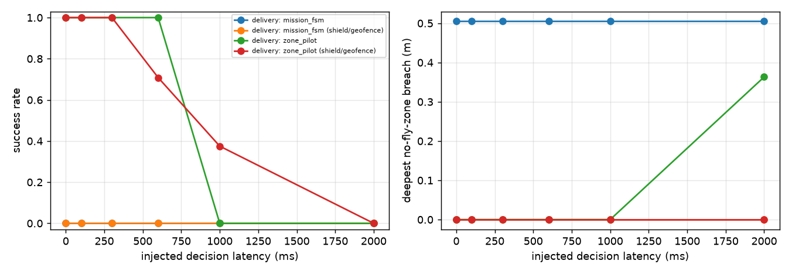

**Prediction: breach depth rises about linearly with latency, so a graded metric adds statistical power. Falsified.** Breach depth is not graded in practice here: it is a flat 0.5 m for the zone-blind pilot (it flies the straight line, which is 0.5 m inside each zone's edge) and exactly 0 for the aware pilot until the pilot fails for a *different* reason. At 1000 ms the aware pilot does not breach a zone; it **overshoots the pad and leaves the arena** (all 24 flights end 6 m past the pad, the out-of-bounds limit, after swinging up to 3 m sideways), which I attribute to its stop-and-land decisions arriving a second late. So the failure the graded metric was meant to expose is invisible to it.

**Two other observations.** The zone-blind pilot with the geofence on never breaches but also never delivers (0 of 24; all 24 time out): the geofence holds it back and it never gets through. For the aware pilot the geofence **hurts at 600 ms** (24 to 17, 7 flights lost, 0 gained, p = 0.016) and **helps at 1000 ms** (0 to 9, p = 0.004). I did not investigate the mechanism; the sign flips with latency, so I would not claim a general rule.

## A3. An intruder that steers into you

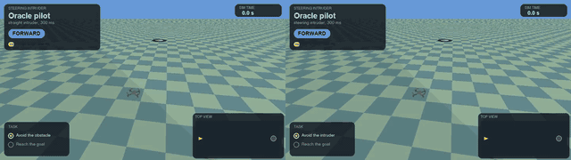

*Left: the oracle pilot at 300 ms against a straight-line intruder on a given seed. Right: the same pilot, same latency and seed, against an intruder that steers toward the drone. The first is passed; the second collides.* Videos: [paired.mp4](../assets/sims/pursuit/paired.mp4), and [compare.mp4](../assets/sims/pursuit/compare.mp4) (0 ms against 300 ms on the steering intruder).

**Task.** An intruder sphere appears ahead and steers toward the drone by proportional navigation (gain 3, at most 1.5 m/s² lateral, 1.2 m/s). The same 24 seeds are also flown against a straight-line intruder, so each comparison is paired.

| latency | oracle, straight | oracle, steering | reflex, steering |
|---|---|---|---|
| 0 ms | 24 | 24 | 13 |
| 100 ms | 24 | 16 | 8 |
| 300 ms | 24 | 9 | 2 |
| 500 ms | 24 | 8 | 4 |
| 800 ms | 22 | 4 | 0 |
| 1200 ms | 21 | 0 | 0 |

*(successes of 24; the oracle is certified at 24 of 24 at 0 ms by construction.)*

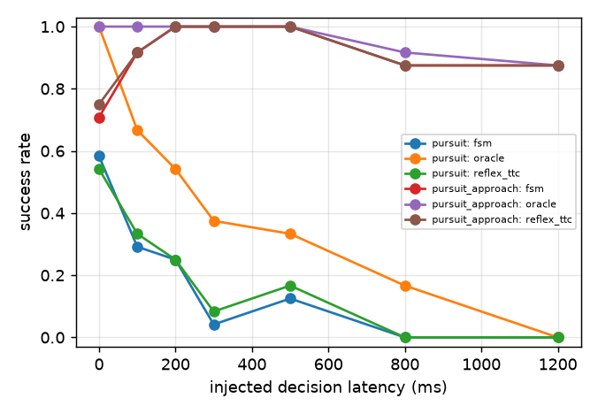

**Prediction: the steering intruder collapses success at least 2× earlier. Held, by a wide margin.** The oracle loses 8 flights to the steering intruder and none to the straight one already at 100 ms (p = 0.008, paired), and the gap widens to 21 flights at 1200 ms (p = 10⁻⁶). The straight intruder stays near 90% up to 1200 ms. A plausible reason is that a steering intruder keeps correcting, so a late dodge is undone by the intruder's own correction; I did not test that directly.

**One oddity.** For the straight intruder the *reflex FSM* does worse at 0 ms (17 of 24) than at 200 to 500 ms (24 of 24). With 24 scenarios I can see it but not explain it; it looks like a timing interaction between the FSM's brake-then-dodge sequence and the intruder's speed, not a real benefit of latency.

## A4. Engine-out landing-site choice

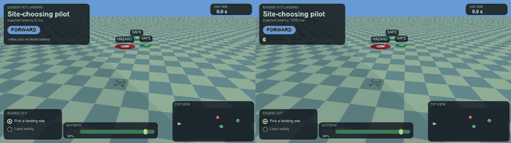

*Left: the site-choosing pilot at 0 ms picks the large safe site and lands in it. Right: the same pilot at 1000 ms lands off-site (a miss).* Video: [compare.mp4](../assets/sims/landing/compare.mp4).

**Task.** At 3 to 4 s the battery collapses and the drone has about 8 s. Three candidate sites lie ahead: a small safe one nearby, a hazard decoy (landing there fails the task), and a large safe one further away. The "best" pilot goes for the large safe site; the "nearest" pilot takes the closest non-hazard site.

| latency | best site | nearest site | best-only wins | nearest-only wins | p |
|---|---|---|---|---|---|
| 0 ms | 24 | 18 | 6 | 0 | 0.031 |
| 300 ms | 24 | 20 | 4 | 0 | 0.125 |
| 600 ms | 24 | 7 | 17 | 0 | 2 × 10⁻⁵ |
| 1000 ms | 6 | 6 | 5 | 5 | 1.0 |
| 1500 ms | 0 | 7 | 0 | 7 | 0.016 |
| 2500 ms | 0 | 3 | 0 | 3 | 0.25 |

*(successes of 24; the pairing is by scenario.)*

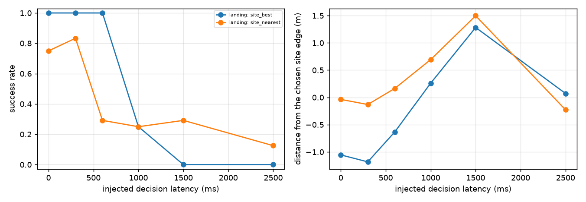

**Prediction: a crossover latency L\* above which "nearest" beats "best". Held.** "Best" wins or ties up to 1000 ms. At 1500 ms "nearest" wins 7 flights to 0 (p = 0.016, unadjusted; across the six latencies tested a Holm correction would put this near 0.08, so call it suggestive). The crossover is therefore between 1.0 and 1.5 s: past that, the far site cannot be reached in the 8 s the battery allows with a decision that slow. At 2500 ms both mostly fail, and 67% of "best" flights crash outright.

## A5. Human vs Jev vs reflex


*Three panels on one scenario: the FSM rule with no latency, the same rule with a human-like reaction time (median 300 ms), and Jev (about 600 ms). The first two avoid the obstacle; Jev collides.* Video: [compare.mp4](../assets/sims/human/compare.mp4).

**This is not a human.** The "human" is the FSM rule applied with a **synthetic human reaction time**: a lognormal around the stated median (σ = 0.4, so a heavy tail). That answers "where would a rule-following person with a human reaction time sit on this curve", not whether a person would follow the rule.

Collision rate on the 56 obstacle and intruder scenarios of the live suite, shield off (paired with Jev by scenario):

| who | latency | collisions | vs Jev (human-only / Jev-only collisions, p) |
|---|---|---|---|
| FSM rule | 0 ms | 9% | 0 / 19, p = 4 × 10⁻⁶ |
| human-like | median 200 ms | 14% | 0 / 16, p = 3 × 10⁻⁵ |
| human-like | median 300 ms | 18% | 0 / 14, p = 1 × 10⁻⁴ |
| human-like | median 450 ms | 41% | 7 / 8, p = 1.0 |
| FSM rule | 550 ms fixed | 54% | 12 / 6, p = 0.24 |
| **Jev 1.13** | measured about 600 ms | **43%** | |
| FSM rule | 1000 ms fixed | 88% | 26 / 1, p = 4 × 10⁻⁷ |

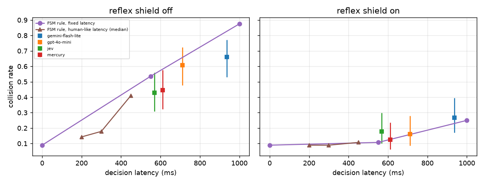

**Prediction: a 250 ms human collides between the 0 ms rule and Jev, nearer the rule. Held.** At 200 and 300 ms the human-like pilot is at 14 to 18%, close to the 9% of the 0 ms rule and far from Jev's 43%. By a median of 450 ms it has reached Jev (41% against 43%, no difference). With the shield on, everyone from 0 to 550 ms is within 9 to 18% and the differences are not significant. In plain terms: **a reaction time of about 450 ms is where a rule-following operator and Jev become equivalent on this suite.** Two honest points on Jev's side: at about the same latency (550 ms for the rule, about 600 ms for Jev) Jev (43%) does better than the FSM rule (54%), though that gap is not significant (p = 0.24); so there is no sign that Jev's judgement is worse than the rule's, only that it is slower.

## A6. Ghost drone: predictive decisions

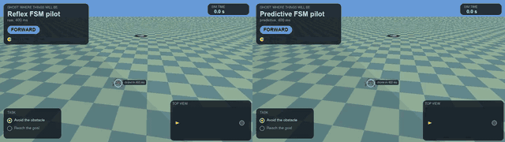

*Rings show where the drone and the obstacle will be when a 400 ms decision lands. Left: the plain FSM collides. Right: the same FSM fed the extrapolated observation passes. **This is a scenario where prediction helped; on average it does not (below).*** Video: [compare.mp4](../assets/sims/ghost/compare.mp4).

**Idea.** The model decides on stale data. Instead of the measured range and time-to-collision, give the rule the values extrapolated by the *expected* latency: `range − closing × L`, `ttc − L`. It cannot know the true latency, so it is told one (200, 400 or 700 ms) and flown against each real latency.

| hazard | latency | raw collisions | predictive (told the right latency) | predictive-only / raw-only collisions |
|---|---|---|---|---|
| constant velocity | 200 ms | 14% | 14% | 0 / 0 |
| constant velocity | 400 ms | 30% | 32% | 3 / 2 (p = 1.0) |
| constant velocity | 700 ms | 61% | 55% | 4 / 7 (p = 0.55) |
| steering intruder | 200 ms | 75% | 83% | 2 / 0 |
| steering intruder | 400 ms | 88% | 88% | 0 / 0 |
| steering intruder | 700 ms | 88% | 96% | 2 / 0 |

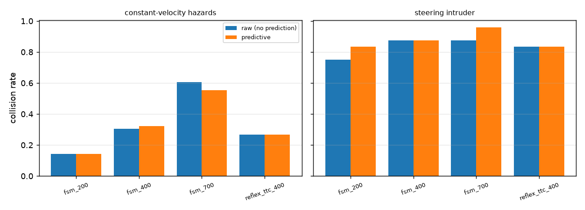

**Prediction: extrapolating recovers at least 50% of the latency penalty for constant-velocity hazards. Falsified.** The recovered share is about 0% at 200 ms, negative at 400 ms, and 6 points of a 52-point penalty (about 12%) at 700 ms (the penalty is the raw collision rate minus the 9% of the 0 ms rule); none is statistically distinguishable from zero. Against a steering intruder it is slightly *worse*, as predicted (the hazard breaks the constant-velocity assumption), but the effect is also not significant. The reflex-TTC arm gives the same picture. Extrapolation moves the decision earlier in the rule's mind but gives it no more time, and the hard collisions are the ones whose reaction budget is shorter than the latency. At 700 ms, 12 of the predictive pilot's 31 collisions were in scenarios whose budget was below 0.7 s; those cannot be fixed by deciding better.

**Not tested:** a learned or better motion model, and telling the *model* (an LLM) its latency in the prompt (idea B1).

---

## A7. Two drones sharing airspace

Written up separately: **[docs/sims/two-drone.md](sims/two-drone.md)**. Videos in `assets/sims/two-drone/`.

Two reflex-arm drones fly head-on, each with its own latency (8,800 flights on a 5 × 5 grid plus equal-sum supplementary cells). Both predictions were **falsified**: collision risk follows the *faster* drone, not the sum of latencies (at equal sums, asymmetric cells collided 0% against 41 to 45% for symmetric ones), and there were **no deadlocks** in 8,800 flights. The write-up flags a modelling choice that matters: the other drone is sensed only within 2 m, picked after pilot runs so the transition falls inside the grid, so the latency at which collisions start is set by that choice, and the structure of the result is what to trust.

## A8. Gate slalom

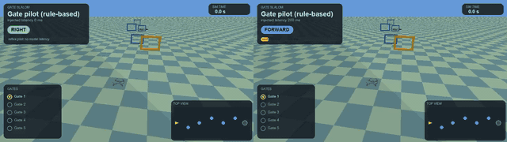

*Left: the gate pilot at 0 ms threads all five gates. Right: at 200 ms the same pilot misses most gates (orange crosses); the banner says GATES MISSED.* Video: [compare.mp4](../assets/sims/gates/compare.mp4).

**Task.** Fly through five gates (0.5 m half-width, 0.3 m height tolerance) at 1.2 m/s without stopping. Adjacent gates are offset by exactly one 1.0 m sidestep and a 0.5 m height step. (An earlier version at 1.5 m/s and 2.6 m spacing was infeasible even for the pilot, so I slowed it; this is "slalom at walking pace", not racing.)

| latency | success (of 24) | gates passed (of 5) |
|---|---|---|
| 0, 50, 100 ms | 24 | 5.00 |
| 200 ms | 0 | 2.96 |
| 300 ms | 0 | 3.00 |
| 500 ms | 0 | 1.29 |

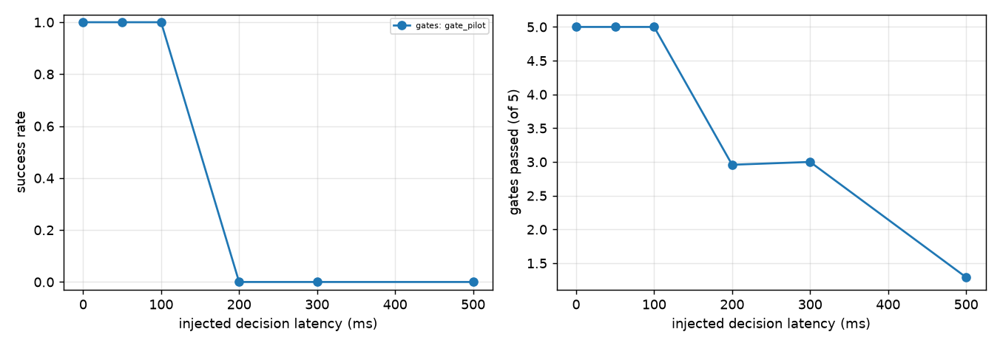

**Prediction: pass rate falls from about 100% to about 0% between 0.2 and 0.8 s. Partly held.** The cliff exists and is sharp, but it sits **between 100 and 200 ms**, earlier than predicted: 24 of 24 at 100 ms, 0 of 24 at 200 ms (I did not sample between them). A likely reason is the tolerance (I did not isolate it): with a 1 m sidestep between gates and a ±0.5 m window, a correction that arrives 200 ms late may already be outside it. This is the most latency-sensitive task in the set.

## A9. Urban canyon with gusts

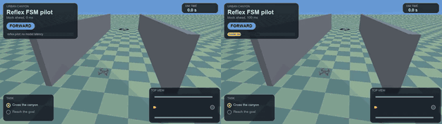

*A corridor between two walls. The video shows the **block variant**: a block to steer around. Left: the FSM at 0 ms goes around. Right: at 100 ms its late sidestep ends in the wall.* Video: [compare.mp4](../assets/sims/canyon/compare.mp4).

**Task.** Two variants: **gust only** (a narrow corridor and one lateral gust of 1.6 to 3.0 m/s², nothing to avoid) and **block** (a wider corridor with a block to steer around, plus the gust). 15 gust-only and 9 block scenarios.

| variant | pilot | 0 ms | 100 ms | 300 ms | 600 ms | 1000 ms |
|---|---|---|---|---|---|---|
| gust only | FSM | 15/15 | 15/15 | 15/15 | 15/15 | 15/15 |
| block | FSM | 9/9 | 1/9 | 0/9 | 9/9 | 5/9 |

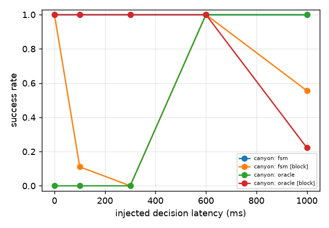

**Prediction: latency does not matter for pure gust rejection but does for branching corridors. Held, but weakly.** Gust-only is flat at 100%, as predicted. **The caveat is that the control is too easy:** across all 75 gust-only flights the drone's peak lateral deviation was 0.15 m on average (0.19 m at most) against about 1.0 m of margin to the wall. The PID absorbs the gust and the decision layer never has to act, so latency cannot matter. This shows that this gust does not need the decision layer, not that the layer is robust to stronger gusts.

**Block variant: a pattern, not a result.** It falls from 9/9 to 1/9 and 0/9, then returns to 9/9 at 600 ms and 5/9 at 1000 ms. That non-monotonic shape suggests the outcome depends on how the decision cadence lines up with the block's arrival, but with nine scenarios I can neither confirm nor explain it. The oracle pilot is left out of this table: in the gust-only corridor it collides in every flight at 0 to 300 ms (0 of 15) and succeeds from 600 ms, which looks like a property of that policy (I suspect it reacts to the walls as if they were obstacles; I did not check), not a latency effect.

## A10. Structure inspection with a camera and a VLM

Written up separately: **[docs/sims/inspection.md](sims/inspection.md)**. Media in `assets/sims/inspection/`.

60 seeded stills (half defective) at 64, 128 and 224 px through three vision models, with a text-only control; 720 scored calls for $0.10. Accuracy saturated near 128 px for gpt-4o-mini (0.95) and gpt-6-luna (0.93), and was flat and poor for Gemini 3.5 Flash-Lite (0.60 to 0.67, because it flags most clean panels). Image size added only **35 to 53 ms** of latency for the OpenAI models and none for Gemini. A demo flight then used the best cell (gpt-4o-mini at 128 px) to give three of three correct verdicts at 0.95 to 1.3 s each. The write-up discloses that the system prompt was tuned on about 30 probe calls on a separate wall, and that the intervals are about ±0.1.

---

## Live models on the tasks

Four live models flew the first 12 scenarios of four tasks, each at its own measured latency (this machine, this network: India), with the rule-based pilot as the ceiling. Models see the same 11-action contract and a compact task block in the prompt (bucketed target offsets, zone state, site list, gate rules). Total cost **$0.72**.

| task | rule-based pilot | Mercury Decide | Jev 1.13 | GPT-4o-mini | Gemini 3.5 Flash-Lite |
|---|---|---|---|---|---|
| Follow-me (success, of 12) | 12 | **12** | 8 | 0 | 3 |
| Follow-me, time in band | 1.00 | 0.90 | 0.86 | 0.62 | 0.73 |
| Gate slalom (success) | 12 | 0 | 0 | 0 | 0 |
| Gate slalom, gates passed (of 5) | 5.00 | 1.67 | 1.58 | 1.58 | 0.67 |
| Landing (success) | 12 | 2 | 0 | 2 | 4 |
| Delivery, no geofence (success) | 12 | 2 | 1 | 1 | 0 |
| Delivery, mean deepest breach | 0.00 m | 0.49 m | 0.47 m | 0.34 m | 0.42 m |
| mean decision latency | about 0 ms | 508 to 553 ms | 510 to 543 ms | 660 to 684 ms | 960 to 1039 ms |

What this says:

1. **Gates: every model fails, as the sweep predicts.** The injected-latency cliff is at 100 to 200 ms and every model takes 500 ms or more, so 0 of 12 for all four is the sweep's answer, not a separate finding about the models.
2. **Follow-me: the fast models can do it and the slow ones cannot.** Mercury (508 ms) completed 12 of 12 against the rule-based pilot's 12 (the pilot's 1.00 band fraction against Mercury's 0.90 is the cost of latency). Jev (536 ms) managed 8 of 12. GPT-4o-mini (660 ms) lost the target on all 12 and Gemini (1017 ms) on 7 of 12. Mercury and Jev differ in this task although their latency is the same, so it is not only latency; with n = 12 the Mercury/Jev gap is not significant (4 scenarios Mercury alone completed, none Jev alone; paired exact p = 0.125).
3. **Delivery: the models mostly ignore the zones.** They do reach the pad (landing on the pad: Jev 11 of 12, Mercury 10 of 12, GPT-4o-mini 3 of 12, the rest mostly crashes), but their deepest breach is 0.34 to 0.49 m, the same as the zone-blind pilot's 0.5 m, so success under the no-breach rule is at most 2 of 12. With the geofence on, breach depth falls for some (Gemini 0.01 m, GPT-4o-mini 0.22 m, Jev 0.31 m) but not for Mercury (0.47 m), and most flights then time out (Jev 11 of 12) without delivering; none succeeded. The prompt tells them to step aside at a blocked zone; they do not reliably do it.
4. **Landing: Jev landed off-site in 12 of 12** (mean miss 0.8 m beyond the site edge), Mercury made 2, GPT-4o-mini 2 (and crashed in 7), Gemini 4. I did not analyse which site each model chose, so I cannot say whether the failures are choice or timing.

These runs are **n = 12 with wide intervals** (a result of 12 of 12 has a lower 95% bound of 0.76; 0 of 12 an upper bound of 0.24), models that are told nothing about the data's age (the `age` field was always 0; see [SIMULATION-IDEAS.md](SIMULATION-IDEAS.md)), and one fixed prompt each. A model with a better prompt or more examples could do differently.

## Caveats that apply to everything above

- **Simulation only**, a Crazyflie-class model and a PID tuned for gentle manoeuvres; the lateral dodge is capped at 1.5 m/s because the stock PID goes unstable above about 3 m/s² commanded acceleration.
- **24 scenarios per cell** (9 to 15 where a task has variants). Differences under about 20 points are not resolved, and several comparisons at one latency are not corrected for multiplicity unless marked.
- **Scenarios are certified by the task's own rule-based pilot**, so they are biased toward ones that pilot can finish; every model and latency sees the same set.
- **Thresholds, speeds and geometry are my choices** (gate spacing, zone size, site radii, intruder gain). Each was picked so the zero-latency pilot succeeds; the *latency at which things break* depends on those choices, and several were adjusted during development (gates, canyon, follow arena) after earlier versions were infeasible. The numbers show the structure, not a universal threshold.
- **The videos show typical contrast cases, not typical flights.** A video is a pair that differs in outcome; the tables are the evidence.
- **Live latency is wall-clock on this machine and network.** Elsewhere the models are faster and the gaps shift.

## Orb Dodge (a game)

A game built after the ten above: homing orbs chase the drone, including a version where a small model steers the orbs against a stronger model flying the drone. See **[sims/orbs.md](sims/orbs.md)**.

## Reproduce

```bash
.venv/bin/python scripts/run_sims.py          # the six rule-based sweeps (about 4 min, no network)
.venv/bin/python scripts/run_human.py         # A5, about 1 min
.venv/bin/python scripts/run_ghost.py         # A6, about 1.5 min
.venv/bin/python scripts/run_sims_live.py     # live models on four tasks (about 28 min, about $0.72)
.venv/bin/python scripts/analyze_sims.py      # tables + charts -> assets/sims/<slug>/
.venv/bin/python scripts/analyze_human.py
.venv/bin/python scripts/analyze_ghost.py
.venv/bin/python scripts/analyze_sims_live.py
.venv/bin/python scripts/render_sims.py       # videos, GIFs, screenshots (about 6 min on 8 cores)
```

A7 and A10 have their own scripts (`scripts/run_two_drone.py`, `scripts/render_two_drone.py`, `scripts/run_inspection_study.py`, `scripts/render_inspection.py`). The experiments live in `data/drone_jev.db` as `sim_*`, `human_baseline` and `sim_ghost_*` (viewable in the dashboard); raw per-cell results are in `assets/sims/<slug>/results.json`.
