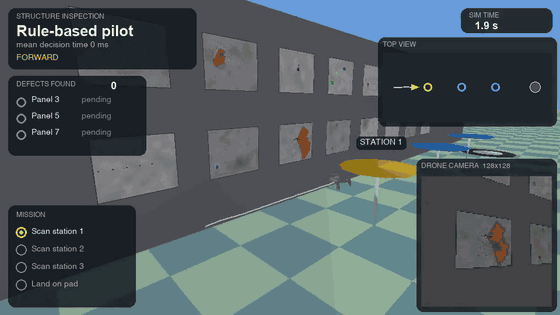
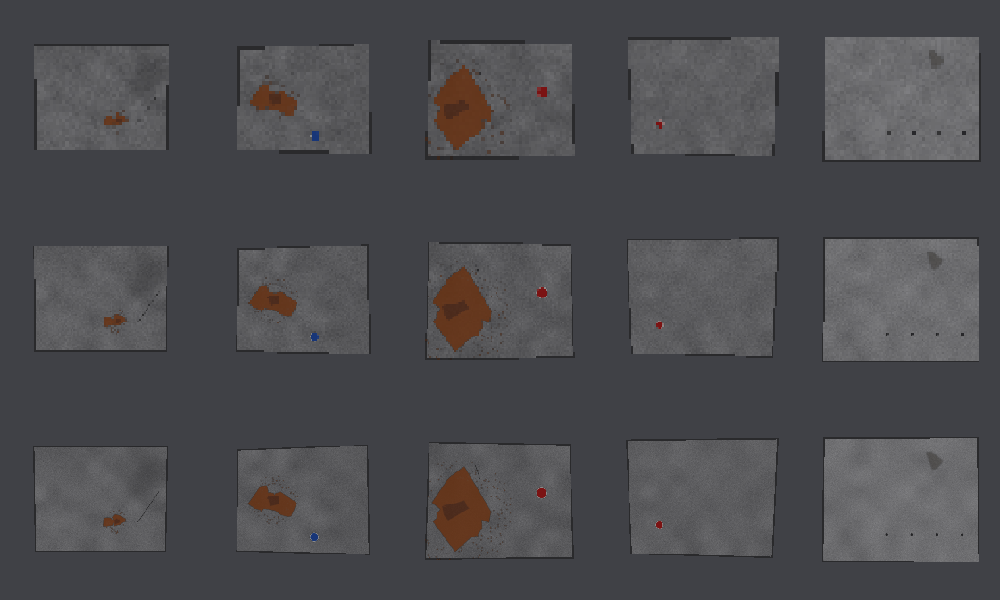
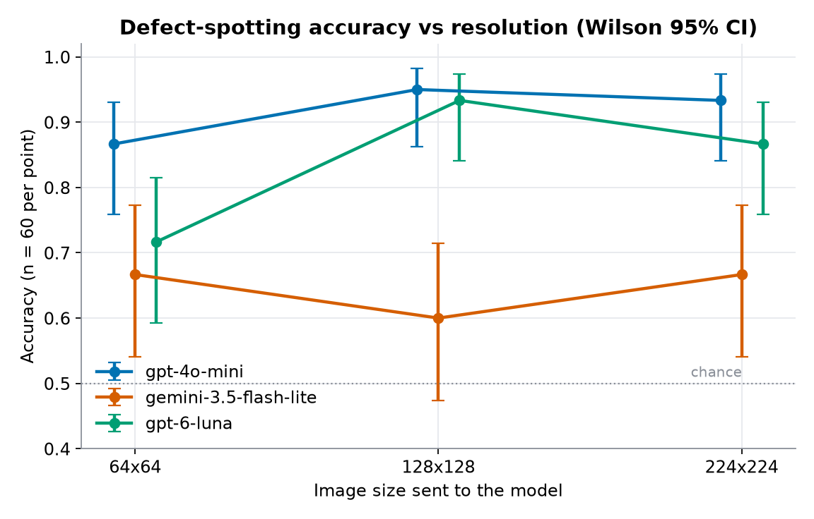
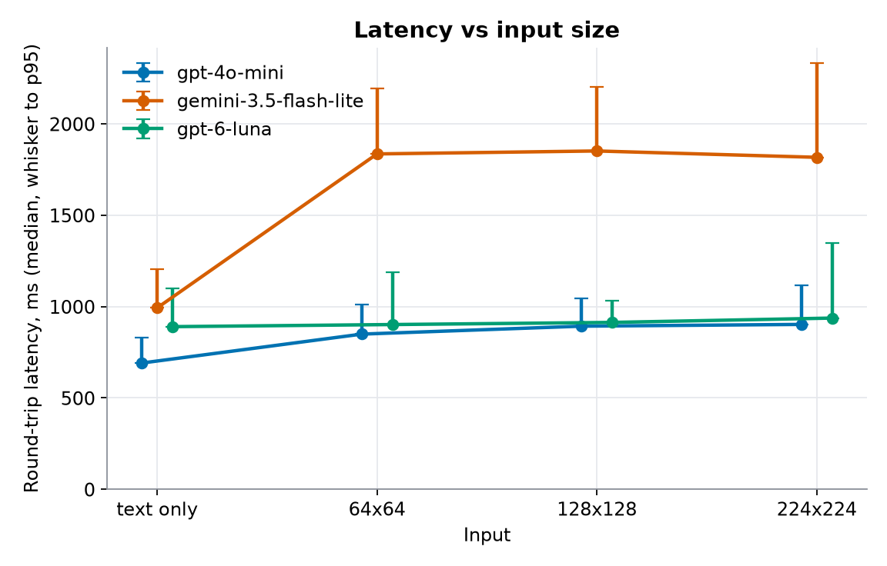
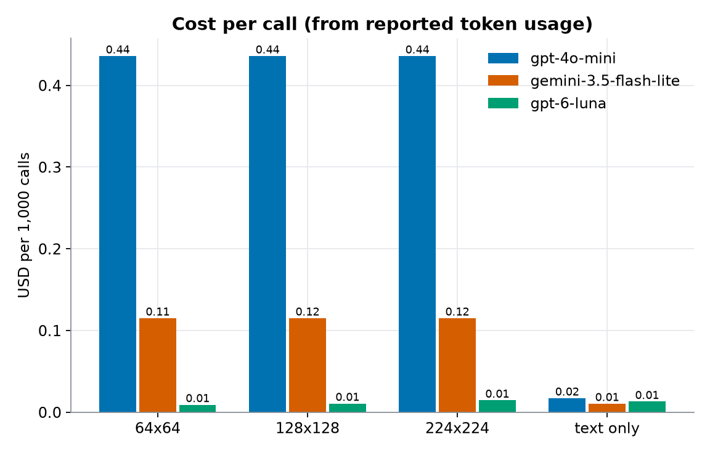

# Structure inspection with a camera and a vision model (idea A10)

Question: **is pixel resolution a latency tax?** A drone camera frame goes to a vision model that must say whether a wall panel shows a defect. Bigger frames cost more bytes (and sometimes tokens); do they buy accuracy, and what do they do to response time?

Prediction written before the run (docs/SIMULATION-IDEAS.md, A10; docs/research/17b, idea 15): *accuracy saturates near 128x128 while latency keeps rising with image size; text-only input is at least 100 ms faster than image input.* It was falsified if accuracy kept improving up to 224x224 or if image size did not change latency.

<p align="center"></p>

<sub>Demo flight: the rule-based pilot flies, GPT-4o-mini reads each panel at 128x128. Full video: <a href="../../assets/sims/inspection/flight.mp4">flight.mp4</a>.</sub>

## What was built

| Piece | File |
|---|---|
| Wall of panels in PyBullet with seeded defects, distractor marks and a gimballed camera | `app/sim/inspection.py` |
| Yes/no vision client (OpenAI chat, Gemini), hard cost cap, answer parser | `app/providers/vision.py` |
| Resolution study and charts | `scripts/run_inspection_study.py` |
| Flight demo: 3D render with picture-in-picture, verdict ticker, defects checklist | `scripts/render_inspection.py`, `app/render/inspection_video.py` |
| Tests (no network) | `tests/unit/test_inspection.py` |

**Scene.** Panels are 1.0 m x 0.8 m on a wall 1.8 m from the flight line. A defective panel carries a dark red jagged crack, a rust-coloured corrosion blotch, or both, each with a seeded size of 12, 25 or 50 cm and a seeded position. Clean panels carry one to three distractors: soft shadows, flat blue/green/yellow stickers, a **round red sticker**, grey-brown smudges, thin grey scratches, rivet rows. Defective panels may carry them too. Everything is drawn from a seed, so labels are exact ground truth. The camera aims at the panel centre from a seeded pose (1.3 to 1.8 m away, small lateral and height offsets) with a 50 degree field of view and renders with PyBullet's tiny CPU renderer. Measured here: 0.7 ms at 64x64, 2.6 ms at 128x128, 7.9 ms at 224x224 per frame (docs/research/17b measured 2 ms and 5 ms for the last two on an untextured scene).

<p align="center"></p>

<sub>Rows: 64, 128, 224 px (all enlarged to the same size). Columns: a 12 cm, a 25 cm and a 50 cm defect, then two clean panels.</sub>

## The resolution study

60 stills (10 walls x 6 panels, exactly 30 defective; 17 of the defective panels have a smallest defect of 12 cm), each rendered from one pose at 64, 128 and 224 px and sent as a **lossless PNG** data URL. Question, verbatim: *"Does this panel show a defect (crack or corrosion)? Answer YES or NO."*, preceded by a one-line context sentence and a one-line system message. Three models, sequential calls with a pause of at least 300 ms, one persistent HTTP/2 client, latency measured with `perf_counter_ns` around the request, call order shuffled by seed. The text-only control replaces the image with a neutral written description of the panel's features (colour, shape, size; the words defect, crack and corrosion never appear). 720 scored calls plus one discarded warm-up per model.

| Model | Input | Accuracy (Wilson 95% CI) | Recall | Recall, smallest defect 12 cm (n=17) | Specificity | p50 ms | p95 ms | Tokens in | USD per 1k calls |
|---|---|---|---|---|---|---|---|---|---|
| gpt-4o-mini (detail low) | 64x64 | 0.867 (0.76 to 0.93) | 0.77 | 0.65 | 0.97 | 849 | 1010 | 2901 | 0.436 |
| gpt-4o-mini | 128x128 | 0.950 (0.86 to 0.98) | 0.90 | 0.82 | 1.00 | 893 | 1044 | 2901 | 0.436 |
| gpt-4o-mini | 224x224 | 0.933 (0.84 to 0.97) | 0.90 | 0.88 | 0.97 | 902 | 1116 | 2901 | 0.436 |
| gpt-4o-mini | text only | 0.983 (0.91 to 1.00) | 0.97 | 1.00 | 1.00 | 691 | 830 | 110 | 0.017 |
| gemini-3.5-flash-lite | 64x64 | 0.667 (0.54 to 0.77) | 1.00 | 1.00 | 0.33 | 1836 | 2192 | 1146 | 0.115 |
| gemini-3.5-flash-lite | 128x128 | 0.600 (0.47 to 0.71) | 0.97 | 1.00 | 0.23 | 1852 | 2201 | 1146 | 0.115 |
| gemini-3.5-flash-lite | 224x224 | 0.667 (0.54 to 0.77) | 0.97 | 1.00 | 0.37 | 1817 | 2334 | 1146 | 0.115 |
| gemini-3.5-flash-lite | text only | 0.883 (0.78 to 0.94) | 1.00 | 1.00 | 0.77 | 993 | 1206 | 100 | 0.010 |
| gpt-6-luna (effort none) | 64x64 | 0.717 (0.59 to 0.81) | 0.57 | 0.35 | 0.87 | 902 | 1188 | 71 | 0.009 |
| gpt-6-luna | 128x128 | 0.933 (0.84 to 0.97) | 0.97 | 0.94 | 0.90 | 913 | 1030 | 86 | 0.011 |
| gpt-6-luna | 224x224 | 0.867 (0.76 to 0.93) | 1.00 | 1.00 | 0.73 | 937 | 1347 | 125 | 0.014 |
| gpt-6-luna | text only | 1.000 (0.94 to 1.00) | 1.00 | 1.00 | 1.00 | 890 | 1099 | 109 | 0.013 |

Two Gemini answers were unparseable and count as wrong; every other call returned YES or NO. Raw per-call records: `assets/sims/inspection/study.json`.

<p align="center">


</p>
<p align="center"></p>

## Did the prediction hold?

Partly, and it depends on the model.

| Clause | gpt-4o-mini | gemini-3.5-flash-lite | gpt-6-luna |
|---|---|---|---|
| Accuracy saturates by 128x128 (224 gains under 5 points) | **Yes.** 0.867, 0.950, 0.933. But 64 is already high and its interval overlaps 128's, so "saturates" here means "no more to gain after 128", not a sharp knee | **Not testable.** Flat at 0.60 to 0.67 at every size; the limit is false alarms (specificity 0.23 to 0.37), not pixels | **Yes.** 0.717, 0.933, 0.867. The big gain is 64 to 128 (recall 0.57 to 0.97); 224 adds recall (1.00) but costs specificity (0.90 to 0.73), so accuracy dips |
| Accuracy still rising at 224 (would falsify) | No | No | No |
| p50 latency rises with image size, 224 minus 64 (bootstrap 95% CI) | +53 ms (+26 to +90). Real but small, about 6% | -19 ms (-83 to +85). **No effect** | +35 ms (+12 to +71). Real but small |
| Text-only at least 100 ms faster than image | **Yes**, 158 to 211 ms | **Yes**, 824 to 859 ms | **No**, 12 to 47 ms (interval includes 0 at 64 and 128) |

What this says:

- **Resolution is not a large latency tax in this range.** Going from 64 to 224 px multiplies the PNG from 2.8 KB to 25 KB and moves p50 by 0 to 53 ms. For gpt-4o-mini (detail low) and Gemini the token count is the same at every size (2901 and 1146), so the model does the same work; only the upload changes. The falsification clause "image size does not change latency" is therefore close to true for two of three models. The sizeable latency cost is **having an image at all**: 1.1k to 2.9k input tokens against about 100 for text.
- **The cost-effective operating point is 128x128**, with the caveat that 64x64 is already adequate for large defects. At 64 px the 12 cm defects are missed far more often (recall 0.65 for gpt-4o-mini, 0.35 for gpt-6-luna) than at 128 (0.82, 0.94).
- **The model matters more than the resolution.** Gemini 3.5 Flash-Lite answers YES to most clean panels (possibly reading the red sticker and other marks as defects; not tested) and is also the slowest by about 1 s. gpt-6-luna at 128x128 matches gpt-4o-mini's accuracy within noise at about 1/40 of the per-call cost (US$0.011 against US$0.436 per 1,000 calls), because gpt-4o-mini's detail-low image costs a flat 2.9k tokens.
- **The text-only control is not an accuracy comparison.** The description names the features explicitly ("a thin jagged dark red line"), so a good score only shows the models can judge a feature list. It is there for latency.
- **Negative results.** (1) Gemini shows no accuracy or latency dependence on resolution. (2) gpt-6-luna's accuracy falls from 128 to 224 because it flags more clean panels; more pixels also give more to misread. (3) Text-only is not faster for gpt-6-luna. (4) The headline "latency keeps rising with image size" is true only at the tens-of-milliseconds level.

## The demo flight

`scripts/render_inspection.py` builds a 2 x 8 wall (seed 5200) next to the flight line and puts three stations in front of lower-row panels 3, 5 and 7. The pattern was fixed before any model call: **defect, clean, defect** (the other 13 panels are drawn by seed for scenery). The existing `MissionFsmArm` flies it through `run_flight` (no obstacles), and the flight scans all three stations and lands on the pad in 21.5 s. At each scan moment the camera frame (128x128 PNG) goes to the study's best cell, chosen by a pre-declared rule (highest accuracy, ties to lower p50 latency): gpt-4o-mini at 128x128. Three paid calls, cached with the image hash in `assets/sims/inspection/verdicts.json`, so re-rendering costs nothing.

| Station | Panel | Truth | Model answer | Latency | Cost |
|---|---|---|---|---|---|
| 1 | 3 | defect | YES | 1311 ms | $0.00044 |
| 2 | 5 | clean | NO | 976 ms | $0.00044 |
| 3 | 7 | defect | YES | 950 ms | $0.00044 |

Three of three correct, which is an anecdote, not a result (the study above is the evidence). The render reuses `MissionRenderer`/`MissionScene` by subclassing in `app/render/inspection_video.py` (the existing renderer is untouched): the wall is added to the scene, the chase camera looks across the flight line at it, and the picture-in-picture is a second private scene showing the drone camera at the model's resolution (nearest-neighbour enlarged so the actual pixels show). Screenshots: [takeoff](../../assets/sims/inspection/takeoff.jpg), [camera approach](../../assets/sims/inspection/camera-approach.jpg), [defect verdict](../../assets/sims/inspection/panel-defect-verdict.jpg), [clean verdict](../../assets/sims/inspection/panel-clean-verdict.jpg), [last panel](../../assets/sims/inspection/last-panel.jpg), [summary](../../assets/sims/inspection/summary.jpg).

## Caveats

- **Small n.** 60 stills per cell; the Wilson intervals are about 0.1 wide on each side, so differences under about 10 points (for example 64 against 128 for gpt-4o-mini) are not established. The 12 cm subgroup has 17 panels.
- **Synthetic structure.** Textures are procedural concrete with painted defects, rendered by a CPU renderer without shadows or camera noise. Real inspection imagery is harder and different; the distractors are my guess at what a model might confuse.
- **Prompt and format.** One wording, PNG at native size, no few-shot examples. gpt-4o-mini sometimes replied "I can't analyze images" with the first wording; a one-line system message fixed it. That was tuned on a handful of probe calls on a wall (seed 7) that is not in the study; the same message is used for every model.
- **Latency** is wall-clock from one machine and network at one time of day, with the call order shuffled. It includes TLS-session reuse but not DNS or connection setup (a warm-up call per model is discarded). It is not a statement about the providers' general speed.
- **Costs** are token counts from the APIs' usage fields times the prices in the repo (`app/providers/openai_chat.py`; Gemini's is the project's assumed price, not fetched), not invoices.
- **Image detail setting.** gpt-4o-mini ran with `detail: low`, which resizes internally, so its resolution dependence is weaker than a `high` setting would show.
- The gimballed camera aims at the panel directly; the drone is not yawed and no pointing error is modelled.

## Reproduce

```bash
uv run python scripts/run_inspection_study.py   # about 18 min; resumes from study.json (delete it to start over)
uv run python scripts/render_inspection.py      # needs ffmpeg; free once verdicts.json exists
uv run pytest tests/unit/test_inspection.py -v  # no network
```

Both scripts need `OPENAI_API_KEY` and `GEMINI_API_KEY` in `.env` (read through `settings`, sent only in request headers) for any call that is not already cached.

## Cost spent

**US$0.116 in total** against a hard cap of US$1.50, enforced in code (`CostCap`, persisted in `assets/sims/inspection/spend.json` so it spans runs). 756 paid calls: 30 probe calls (API formats and the system-message check, on the seed-7 wall), 720 study calls (US$0.104), 3 discarded warm-ups, 3 demo calls (US$0.0013).
