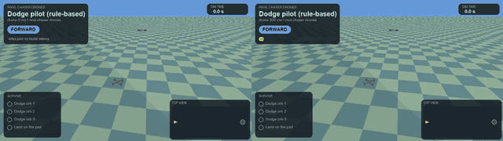
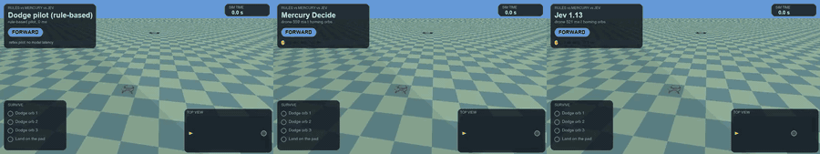
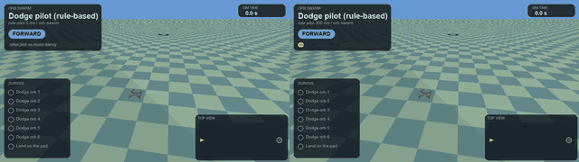
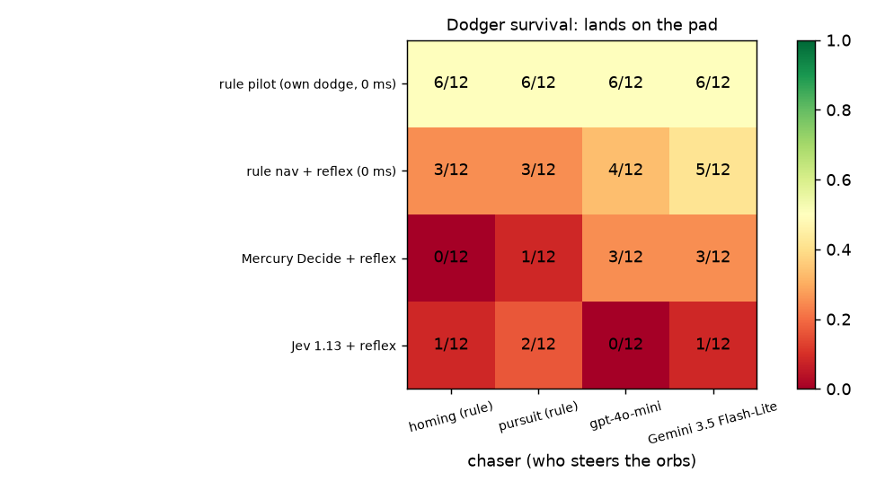
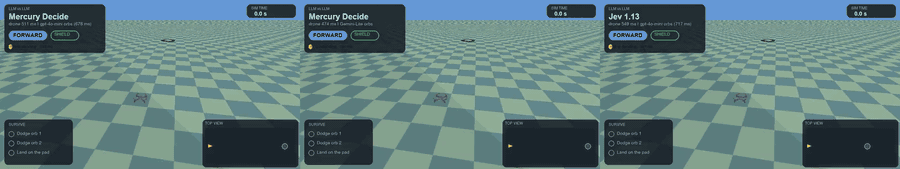

# Orb Dodge: a game where homing orbs chase the drone

A small arena game built on the same simulator. Three glowing orbs appear one after another and home in on the drone. The drone has to dodge all three and land on the pad. The drone is the real PyBullet quadrotor with the real PID; the orbs are stylised game objects (see "What is and is not physical"). There are six variants:

1. **Rule-steered orbs** (proportional navigation, or pure pursuit) against a rule-based dodge pilot, sweeping the drone's decision latency.
2. **A small language model steers the orbs** while a stronger model flies the drone.
3. **Rival chaser drones** instead of orbs: the same chasers drawn as drone models.
4. **Rule-based pilot against Mercury and Jev** on the same scenarios, and every pairing of who chases and who dodges.
5. **Swarms**: six chasers in waves of two.
6. **A randomised tournament**: every dodger against every chaser, rule or model on either side.

Everything is simulation and a game. Nothing here is a model of real weapons or of a real aircraft, and the orbs use a textbook steering law with a turn-rate limit.


*Left: Mercury Decide flies the drone against orbs steered by gpt-4o-mini; it dodges all three and lands. Right: the same flier on the same scenario against rule-based pursuit orbs; it dodges all three but overshoots the pad and leaves the arena.* Video: [orb-duel.mp4](../../assets/sims/orbs/duel/orb-duel.mp4).

## What is and is not physical

- **Physical:** the drone (Crazyflie model, 240 Hz physics, the same PID and wind as the rest of the project), contact detection between the drone and an orb, and the latency of every decision (applied on simulation time).
- **Game objects, not physics:** the orbs move kinematically at constant speed (1.0 m/s) and turn at most 1.1 m/s² sideways. Rival chaser drones use exactly the same motion; they are a drone *picture*, not a second simulated quadrotor (the project's separate two-drone study, [two-drone.md](two-drone.md), does simulate two real drones). I have not tried to make the orbs physically accurate, and the result should not be read as saying anything about real aircraft.
- **Sensing:** an orb is only 0.25 m across, and the 16-ray sensor (22.5° apart) usually misses it until it is about 1 m away. So the drone has a "radar": an orb counts as a 0.5 m disc, giving range, bearing and closing speed. This is a design choice that makes the game playable; without it nothing could dodge.

## Rules and the reference pilot

Orbs spawn when the drone reaches fixed distances (about 3.5, 7.5 and 11.5 m), 4.5 to 6 m ahead and up to 1.4 m to the side. The drone must dodge them and land on a pad about 8 m past the last trigger.

The reference **dodge pilot** is deliberately simple. Orbs turn slowly, so a dodge that starts early is out-turned; it waits until an orb is inside 0.9 m (radar range), steps away from its bearing, holds that side for 0.4 s, and holds its lane while any orb is within 9 m (otherwise it re-centres into the next orb, which is what broke my first version). I tuned the trigger range and hold time on ten and then twenty scenarios, so it is tuned to this game. Scenarios are **certified**: only seeds where this pilot survives the homing orbs at 0 ms are used (24 of them, seeds 6001 to 6038), so "24 of 24" for it at 0 ms is by construction.

## Part A: latency against rule-steered orbs

24 certified scenarios; successes of 24 (survive all three and land on the pad):

| drone decision latency | homing (PN) orbs | pursuit orbs, orb brain 0 ms |
|---|---|---|
| 0 ms | 24 (certified) | 10 |
| 300 ms | **0** | 1 |
| 600 ms | **0** | 0 |

- **Homing orbs punish latency at once.** The same pilot that is perfect at 0 ms loses every flight at 300 ms. A dodge that needs to start within about 0.9 m of an orb cannot tolerate a 300 ms delay.
- **Pursuit orbs are much deadlier than homing ones** even at 0 ms: 10 of 24 against 24 of 24 (the homing set is the certified one, so this comparison is biased toward homing; I did not certify the pursuit set, so some pursuit scenarios may be unwinnable for this pilot).
- **A slow orb brain helps the drone, mildly.** At 0 ms drone latency, giving the pursuit orbs a decision delay of 0, 300, 600 and 1000 ms gives 10, 14, 15 and 16 survivals of 24 (0 against 1000 ms: 3 flights lost, 9 gained, exact p = 0.15, not significant). The direction is as expected, and the sample cannot confirm it.

A second variant gives the dodging to a **zero-latency reflex layer** (the same dodge rule, no model delay) and leaves a navigation-only pilot to fly the mission. Against homing orbs it survives 10, 4 and 3 of 24 at 0, 300 and 600 ms drone latency, and 9, 1 and 0 against pursuit orbs. The reflex helps at 300 and 600 ms against homing orbs (from 0 of 24 to 4 and 3) but is far from a fix: stale navigation commands still steer the drone into the next orb. I did not tune this layer beyond sharing the pilot's rule.

## Part B: a strong model flies, a small model steers the orbs

The drone is flown by Mercury Decide or Jev 1.13 (about 510 to 540 ms per decision) with the reflex layer on; the orbs are steered either by rules (homing, pursuit) or by **gpt-4o-mini**, which sees only where the drone is relative to its own heading and answers one letter (turn left, straight, turn right; about 680 to 780 ms per decision). Eight of the 24 scenarios, each model at its own measured latency. Total spend $0.07.

| drone flier | homing orbs | pursuit orbs | gpt-4o-mini orbs |
|---|---|---|---|
| Mercury Decide | 3 / 8 | 0 / 8 | 3 / 8 |
| Jev 1.13 | 0 / 8 | 0 / 8 | 1 / 8 |

(survivals of 8). What this says, with n = 8 and 95% intervals running from about 0 to 0.7:

- **The small model is a worse chaser than the rules.** Against Mercury, pursuit orbs won all 8, gpt-4o-mini orbs only 5 (three survivals Mercury would not have against rules; exact p = 0.25, not significant). The expected ordering held but I cannot call it a result.
- **Mercury beat Jev here (3 against 1 of 8 in the best column)**, also not significant. Failures of the model-flown drone are mostly crashes (6 of 8 Jev flights against the small model's orbs left the arena or hit the ground) rather than orb hits: the drones dodge, then drift.
- Nothing here separates the two fliers; it shows the game is hard for a 500 ms decision layer.

## Rival chaser drones



Same chasers and the same recorded flights as the homing-orb video, drawn as drone models. Video: [chaser-drones.mp4](../../assets/sims/orbs/chaser-drones/chaser-drones.mp4).

## Rule-based pilot vs Mercury vs Jev

The same scenarios, three fliers: the rule-based dodge pilot (0 ms, dodges by itself) and Mercury Decide and Jev 1.13 (about 520 to 540 ms, reflex layer on). Survivals of the first 8 scenarios:

| flier | homing orbs | pursuit orbs |
|---|---|---|
| rule-based pilot, 0 ms | 8 (certified) | 5 |
| Mercury Decide | 3 | 0 |
| Jev 1.13 | 0 | 0 |

The pilot is not a fair opponent: it has no latency and its dodge rule is tuned to this game, so this shows how large the gap between a zero-latency rule and a 0.5 s model is, not which model is better. Videos (three panels, same scenario): [homing orbs](../../assets/sims/orbs/rule-vs-models/rule-vs-models-homing.mp4), [pursuit orbs](../../assets/sims/orbs/rule-vs-models/rule-vs-models-pursuit.mp4).



## Who chases, who dodges

One chaser that tries to touch the drone and one flier that dodges, each played by a rule or a model. Survivals of the same 8 scenarios (the dodger survives):

| dodger \ chaser | rule-based pursuit | gpt-4o-mini steers the orbs |
|---|---|---|
| rule-based pilot (0 ms) | 5 | 6 |
| Mercury Decide | 0 | 3 |
| Jev 1.13 | 0 | 1 |

A small model as the chaser is no better than the rules and probably worse: against the rule-based pilot it let the pilot survive 6 times against 5 (the pilot survived in 2 scenarios only against the model and 1 only against the rules, exact p = 1.0), and against Mercury the model-steered orbs got the drone 5 times against 8 for the rules. That ordering is as expected, but at n = 8 it is a hint. Video (rule against rule, rule against a model chaser, a model against a model): [roles.mp4](../../assets/sims/orbs/roles/roles.mp4).

## Swarms

Six orbs arrive in waves of two (triggers about 3.5, 7.5 and 11.5 m). Each orb homes independently; there is no coordination, so a swarm is simply more orbs at once. About 13% of random swarm seeds are winnable by the rule-based pilot at 0 ms, and the 24 certified scenarios used here (seeds 7003 to 7181) are exactly those, so the pilot's 24 of 24 against homing swarms is by construction.

| flier | homing swarm | pursuit swarm |
|---|---|---|
| rule-based pilot, 0 ms | 24 / 24 (certified) | 4 / 24 |
| rule-based pilot, 300 ms | 0 / 24 | 0 / 24 |
| Mercury Decide (about 520 ms, reflex on) | 0 / 8 | 0 / 8 |
| Jev 1.13 (about 520 ms, reflex on) | 0 / 8 | 0 / 8 |

The swarm is overwhelming at any latency above zero; no flight with a model in the loop survived. Videos: [swarm, 0 ms against 300 ms](../../assets/sims/orbs/swarm/swarm.mp4), [rule against Mercury against Jev](../../assets/sims/orbs/swarm/swarm-models.mp4), and the [rival-drone swarm](../../assets/sims/orbs/swarm/swarm-drones.mp4) (the same flights drawn as drones).



## Tournament: every dodger against every chaser, on randomised scenarios

A round robin on **12 randomised scenarios** (seeds 9000 to 9011), with the same 12 for every pairing. Each scenario draws 2 to 5 orbs in waves of one or two, an orb speed of 0.8 to 1.3 m/s and a turn rate of 0.9 to 1.5 m/s², a small steady wind (up to 0.25 m/s²) and turbulence (up to 0.15 m/s²). **They are not certified**, so some may be unwinnable.

- **Dodgers (the drone):** the rule-based pilot (its own dodge, 0 ms); a rule **navigation pilot with the zero-latency reflex dodge** (the same architecture the models fly, with no model delay); Mercury Decide and Jev 1.13, both with the reflex layer (about 500 to 530 ms per decision).
- **Chasers (who steers the orbs):** rule homing; rule pursuit; **gpt-4o-mini** (about 700 ms per decision); **Gemini 3.5 Flash-Lite** (about 1.0 s).

Survivals of 12 (the drone lands on the pad):

| dodger \ chaser | homing (rule) | pursuit (rule) | gpt-4o-mini | Gemini-Lite | all four |
|---|---|---|---|---|---|
| rule pilot, 0 ms | 6 | 6 | 6 | 6 | **24 / 48** |
| rule nav + reflex, 0 ms | 3 | 3 | 4 | 5 | 15 / 48 |
| Mercury Decide + reflex | 0 | 1 | 3 | 3 | 7 / 48 |
| Jev 1.13 + reflex | 1 | 2 | 0 | 1 | 4 / 48 |



**Who dodges best.** The rule pilot (50%) is ahead of everything. Against it the pairs are paired by scenario and chaser (n = 48): it beats Mercury (20 scenarios it alone survived against 3, Holm-adjusted p = 0.002) and Jev (20 against 0, p = 10⁻⁵), and is not significantly ahead of the rule navigation pilot (15 against 6, p = 0.17 after adjustment). The two models are indistinguishable (Mercury 7 against Jev 4 of 48, p = 0.55). The rule navigation pilot with the same reflex that the models get does about twice as well as they do (15 against 7 and 4 of 48), which points at the **model's 0.5 s navigation**, not the reflex, as what costs them; the sample is too small for me to call that gap significant after adjustment (navigation pilot against Jev, adjusted p = 0.05).

**Who chases best** (a hit means the orb touched the drone; hits per 48 flights): rule homing 29 (60%), rule pursuit 24 (50%), Gemini-Lite 17 (35%), gpt-4o-mini 11 (23%). Rule homing beats gpt-4o-mini clearly (adjusted p = 0.002) and rule pursuit beats it too (p = 0.02); the other pairs are not significant (n = 48 each). So **a small language model is a worse chaser than a few lines of rules**, which fits its 0.7 to 1.0 s decision time against a drone that dodges in a fraction of a second. Gemini-Lite is slower than gpt-4o-mini and hit more often (17 against 11, p = 0.15, not significant), so latency alone does not order them.

**Reading the counts.** Many failures are not hits: the drones often dodge and then leave the arena sideways or overshoot the pad (outcome "crash"), especially with the models in charge (for example Jev against gpt-4o-mini: 4 hits, 8 crashes, 0 landings). A "hit" rate and a survival rate therefore say different things, and both are in `assets/sims/orbs/tournament/results.json`.

Spend was $0.17 (Gemini is not priced in this project, so it counts as $0 and the total is understated). Videos, three matchups on the same scenario: [LLM against LLM](../../assets/sims/orbs/tournament/tournament-llm-vs-llm.mp4), [rule against rule](../../assets/sims/orbs/tournament/tournament-rule-vs-rule.mp4), [mixed matchups](../../assets/sims/orbs/tournament/tournament-mixed.mp4).



**Caveats.** 12 scenarios per cell (a cell of 12 has a 95% interval about 0.3 wide at best). The pilot's identical 6 of 12 against every chaser suggests its result is set by the scenarios rather than the chaser; I did not check whether it is the same six. The reflex layer, the dodge rule and the radar are my design, and the models were never tuned for this prompt.

## Reproduce

```bash
.venv/bin/python scripts/run_orb_game.py     # parts A, B (live duel, about 7 min, $0.07), C (role swap) and S (swarms, about 4 min)
.venv/bin/python scripts/render_orbs.py      # videos, GIFs, screenshots (about 6 min)
ORB_PARTS=T .venv/bin/python scripts/run_orb_game.py    # the tournament (about 16 min, about $0.17)
.venv/bin/python scripts/analyze_orb_tournament.py      # table, paired tests, heatmap
```

`ORB_PARTS` picks parts (default `ABCS`; `A` is the no-network part). Flights are saved in `data/orb_game/`; the summary is `assets/sims/orbs/results.json`. Code: `app/sim/world.py` (orb steering and radar), `app/harness/orb_control.py` (orb brains with sim-time latency), `app/providers/orb_llm.py` (the small-model orb brain), `app/controllers/sim_arms.py` (`OrbDodger`, `OrbPilot`), `tests/unit/test_orbs.py`.

## Caveats

- **n = 24 and n = 8.** Part B in particular cannot separate the models; treat it as a demo with numbers, not a benchmark.
- **The pilot, the radar and the orb speed were tuned until the game was playable.** The latency at which it breaks is a property of those choices.
- **Orbs are kinematic.** There is no orb mass, drag or thrust model, so "perfect physics" applies to the drone only.
- **Pursuit orbs are not certified**, and the model-flown runs use the same (pilot-certified, homing) seeds.
- The "crash" outcome includes leaving the 6 m arena sideways or flying past the pad (labelled "left the arena" in the video when it applies), not only hitting the ground.
