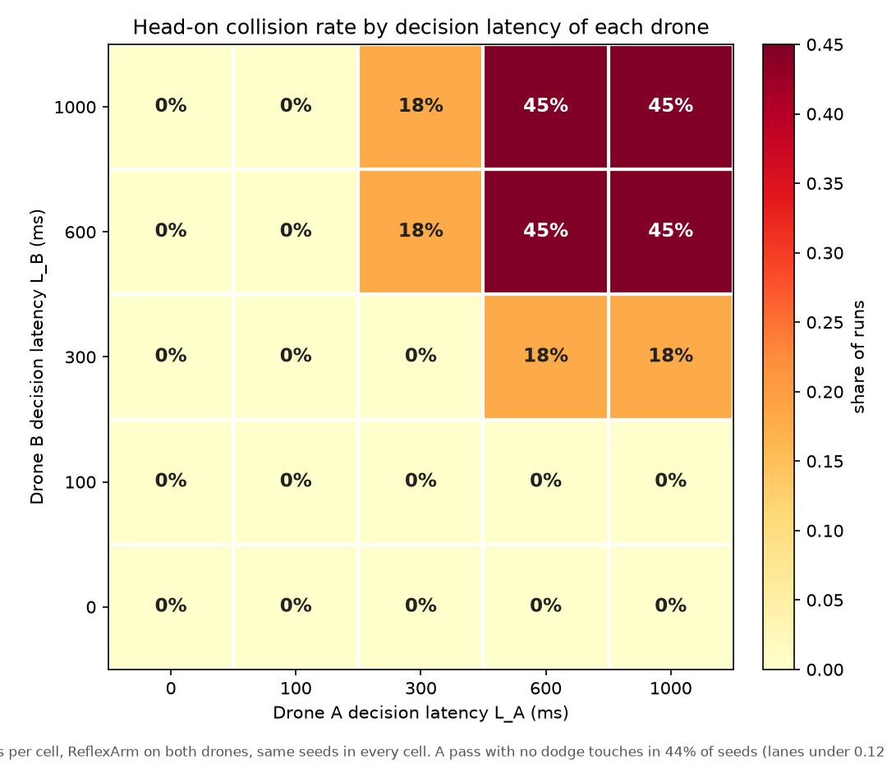
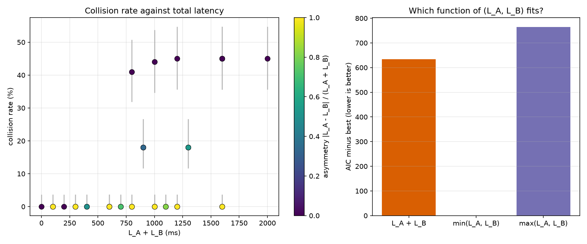

# Two-drone airspace (idea A7)

Two simulated Crazyflies fly toward each other in a corridor. Each has its own decision arm and its own injected decision latency. The question (from [SIMULATION-IDEAS.md](../SIMULATION-IDEAS.md), A7) is whether collision risk depends on the *sum* of the two latencies, and whether symmetric controllers deadlock.

**Short answer: both predictions were falsified.** Collisions follow the *faster* drone, not the sum, and the symmetric pair never deadlocked (0 of 500 equal-latency head-on runs at 400 ms or more). Details, including what was and was not tested, are below.

## What is built

| File | What |
|---|---|
| `app/sim/two_drone.py` | `TwoDroneWorld`: one PyBullet client, `num_drones=2`, `Physics.PYB` (not `PYB_DW`, which crashed a drone in the feasibility spike), 240 Hz physics, 48 Hz control, CF2X. One `DSLPIDControl` and one `ActionExecutor` per drone. `run_pair` flies an encounter with one `DecisionProvider` and one `LatencyPolicy` per drone. |
| `scripts/run_two_drone.py` | The sweep, figures and statistics. Constants at the top, no CLI args. |
| `app/render/two_drone_video.py`, `scripts/render_two_drone.py` | 3D replay (PyBullet renderer, Pillow HUD), videos, GIF, screenshots. |
| `tests/unit/test_two_drone.py` | 12 tests: determinism, contact, per-drone latency ticks, zero-latency clean passes, collision at huge latency, deadlock detector, non-blank renderer frames. |

How it reuses the single-drone code, without changing it:

- **Frames.** Each drone has its own frame (x toward its goal, y to its left), so `ReflexArm`, `FsmArm` and the prompt encoder work unchanged. Conversion to world axes happens only at the PID boundary.
- **Observation.** A normal `Observation`. The other drone is a return in the 16-ray ring (and so in `sectors`, `fwd_range`, `nearest_range`), and `closing_speed` / `ttc` describe it. The same numbers are in `Observation.extras` as `other_range`, `other_bearing_deg`, `other_closing`, `other_ttc`, `other_rel_x/y`, `other_vx/y`, `other_visible`.
- **Latency.** The same rule as the harness: a request is issued only when none is in flight, and its answer is applied `max(1, ceil(L/dt))` ticks later; the previous action stays in force meanwhile. At L = 600 ms the drone therefore looks at the world about every 0.6 s, so the effective reaction delay is up to about twice L.
- **Outcome per run.** Collision (a `getContactPoints` hit, or surface clearance of 0 or less, i.e. centre distance of 0.12 m, two drone radii; a ground crash right after a touch also counts), minimum separation, whether both reached their goals, a deadlock flag (both drones, not yet at their goals, make under 0.45 m of progress per second while within 3 m, for more than 4 s), and which world side each drone dodged to first. Near miss: no contact but surface clearance under 0.3 m.

Scenarios: **head-on** (10 m apart, same altitude, each flying to the other's start point at 1.5 m/s, one lane shifted by a seeded 0 to 0.3 m) and **perpendicular** crossing (supported and swept on a small grid). Every run is seeded and deterministic; `handedness="shared"` mirrors drone B's lateral axis so that "left" means the same world side for both.

## Modelling choices you should know about

- **Sensing is analytic.** A 0.06 m body would slip between 22.5 degree rays, so the other drone is a disc of radius 0.45 m in the ray test. It is visible only inside `sense_range_m = 2.0` surface metres, which at a 3 m/s closing speed is about 0.7 s of warning. **This was chosen after pilot runs (6 to 10 seeds) to put the transition inside the 0 to 1000 ms grid.** With the 10 m ray range of the single-drone world, nothing collided anywhere in the grid (see the sensitivity block below). The latency at which collisions start is therefore set by this choice; the structure of the result (below) is what to trust.
- **The collision ceiling is about 44%.** With lanes offset by 0 to 0.3 m, only seeds whose lanes are under 0.12 m apart touch if nobody dodges: 44 of 100 seeds. The heat-map maximum of 45% is one seed above that count (probably a lane just over 0.12 m that touched through tracking wobble; not investigated). No cell can go much higher, so rates are relative to that ceiling.
- **No yaw**, as in the single-drone project; the drones do not face each other in the video.

## Sweep

100 seeds per cell, the same seeds in every cell, `ReflexArm` (tuned parameters) on both drones. 88 cells, 8,800 flights, about 8 minutes on 6 workers. Raw data: `assets/sims/two-drone/results.json`.

Collision rate (%), rows L_B, columns L_A:

| L_B \ L_A | 0 | 100 | 300 | 600 | 1000 |
|---|---|---|---|---|---|
| **1000** | 0 | 0 | 18 | 45 | 45 |
| **600** | 0 | 0 | 18 | 45 | 45 |
| **300** | 0 | 0 | 0 | 18 | 18 |
| **100** | 0 | 0 | 0 | 0 | 0 |
| **0** | 0 | 0 | 0 | 0 | 0 |



Near misses (clearance under 0.3 m, no contact) are 0 up to (100, 100), 40 of 100 at (300, 300), and 55 of 100 at (600, 600) and (1000, 1000); the near-miss map is `heatmap-near-miss.png`. The table is symmetric: (L_A, L_B) against (L_B, L_A) differed in none of the 10 pairs (exact McNemar on the same seeds), as it should since both drones run the same arm.

## Did the predictions hold?

### (a) Collision probability is a function of L_A + L_B: **falsified**

Direct test on equal-sum cells (same seeds; (L, 0) and (0, L) pooled against (L/2, L/2); exact McNemar, Holm-corrected over the five totals, with Fisher exact as a check):

| L_A + L_B (ms) | asymmetric (L,0) and (0,L) | symmetric (L/2,L/2) | Holm p (McNemar) |
|---|---|---|---|
| 600 | 0% | 0% | 1 (both zero, uninformative) |
| 800 | 0% | 41% | 8e-25 |
| 1000 | 0% | 44% | 2e-26 |
| 1200 | 0% | 45% | 8e-27 |
| 1600 | 0% | 45% | 8e-27 |

The asymmetric case is *safer*, not worse: one fast drone is enough, because its sidestep opens the lane for both. The prediction's stated falsifier ("the slow drone dominates") is not what happened either; the fast drone dominates. A three-parameter model `ceiling x sigmoid(a + b x)` fitted to all grid and equal-sum runs gives AIC 1379 with `x = min(L_A, L_B)`, against 2013 with `x = L_A + L_B` and 2144 with `x = max(L_A, L_B)`. The sum is not the right variable; the minimum is a far better one, though not exact (at (300, 300) nothing collides but (600, 300) collides 18%, so the slower drone matters a little).

The only equal-sum comparison on the requested 5x5 grid itself, (600, 0) against (300, 300), is 0% against 0%: consistent with the prediction but uninformative. The supplementary cells were added for that reason.

### (b) Equal-latency symmetric controllers deadlock or mirror in at least 10% of head-on cases at 400 ms or more: **falsified for deadlock; mirroring depends on a convention**

| Setup (equal latency, at least 400 ms) | n | deadlock | both dodged the same world side |
|---|---|---|---|
| ReflexArm, each drone's own left/right | 500 | 0 (95% CI 0 to 0.8%) | 0 |
| ReflexArm, shared left/right (B mirrored) | 200 | 0 | 55% (p under 1e-50 against 10%) |
| FsmArm, each drone's own left/right | 200 | 0 | 0 |
| FsmArm, shared left/right | 200 | 0 | 0 |

- **No deadlock in any run of any block** (8,800 flights; every non-collision run ended with both drones at their goals). The detector works: a unit test with two always-hover drones 2.5 m apart is flagged at about 5 s. These arms keep moving or dodge, so they do not stall.
- **Mirroring is a convention, not a latency effect.** If "left" is each drone's own left, two drones that both pick the free side (and the tie goes to AVOID_LEFT) dodge to *opposite* world sides and pass safely at 0 ms. If both drones' "left" is the same world side (the shared-frame block), every pair mirrors at 0 to 300 ms (100%) and 55% at 600 ms and above, the rest colliding before either dodged. That block has real consequences: 12% collisions at (0, 0), 45% at (100, 100) and 60% at (300, 300), the last above the 44% that no dodging at all would give, so mirrored dodging is worse than not dodging there. That is mirroring without deadlock: the drones keep moving, then collide or pass.
- So (b) holds only in the weak sense that a mirrored pair can be worse than none, and only under the shared-side convention at a latency range (about 100 to 300 ms) below the 400 ms the prediction named.



### Supplementary results

- **Sensing range.** With a 4 m detection range only (1000, 1000) collides (45%); with 10 m nothing collides up to (1000, 1000). The transition moves with the warning time; the min-rule structure is not tested at those ranges beyond the diagonal.
- **Perpendicular crossing** (ReflexArm, 3x3 grid of 0, 300, 1000 ms): collision rates 38% at (0, 0), 17% (0, 300), 23% (0, 1000), 15% (300, 0), 58% (300, 300), 59% (300, 1000), 20% (1000, 0), 60% (1000, 300), 53% (1000, 1000). Collisions at zero latency are a sensing limit (the forward-corridor ray test sees crossing traffic only at the last moment), not a latency effect, and the lane/timing offsets give a different ceiling. Small cells; not analysed further.
- **FsmArm** on both drones tracks the reflex result for equal latencies (0 collisions up to 100 ms, 40 near misses at 300 ms, 45% collisions at 600 ms and above).

## Videos and screenshots (`assets/sims/two-drone/`)

How the runs were chosen (rule fixed before looking at footage, in `scripts/render_two_drone.py`): take the "late" cell (600, 600) ms and the "fast" cell (0, 0) ms. Of the seeds that collide in the late cell and pass with at least 0.3 m clearance in the fast cell (45 seeds), render the one with the **median collision time** (seed 1078), not the most dramatic. Both videos show the same encounter with different latencies.

| File | Content |
|---|---|
| `flight-collision.mp4` | Seed 1078 at (600, 600): neither drone's decision has arrived when they meet, contact at 3.5 s. It is the collision run. |
| `flight-clean.mp4` | Seed 1078 at (0, 0): both drones AVOID LEFT, which are opposite world sides, closest clearance 1.29 m. |
| `highlight.gif` | 560 px, 8 fps, from the collision run around the contact. |
| `shot-1` to `shot-3` | Collision run: approach (clearance 5 m), closing (1.5 m, both decisions still in flight), contact. |
| `shot-4` to `shot-6` | Clean run: dodge, closest approach, after the pass. |

The video slows to 0.4x while the drones are within 2.5 m (shown on screen). Drone A is blue, drone B magenta; models are drawn 6x larger than real. The HUD shows each drone's action, a bar for its in-flight decision, separation in a green, amber or red danger colour, and sim time. Videos are H.264 yuv420p, crf 28, preset slow; sizes are 0.3 and 0.6 MB, the GIF 0.6 MB.

## Caveats

- One seed range (1000 to 1099), one machine; runs are deterministic here but bitwise PyBullet reproducibility across platforms is not claimed.
- Only two arms were tested (reflex, FSM). Jev or an LLM on one drone is supported by the interface (any `DecisionProvider`) but not run here.
- Pilot runs informed the sensing range (above); all reported numbers are from the final sweep.
- Sidestep geometry is the executor's 1.2 m step; the lane offsets are 0 to 0.3 m, so "dodge or not" dominates and rates are step-like in latency.
- Statistics: with 100 shared seeds per cell and step-like outcomes, p-values on the equal-sum tests are extremely small; the effect sizes (0% against 41 to 45%) matter more than the p-values.

## Reproduce

```bash
.venv/bin/python scripts/run_two_drone.py      # about 8 min on 6 workers; writes results.json and the figures
.venv/bin/python scripts/render_two_drone.py   # about 50 s; needs ffmpeg; reads results.json
.venv/bin/pytest tests/unit/test_two_drone.py
```

Set `REUSE_RESULTS = True` in `scripts/run_two_drone.py` to re-analyse an existing `results.json` without flying.
